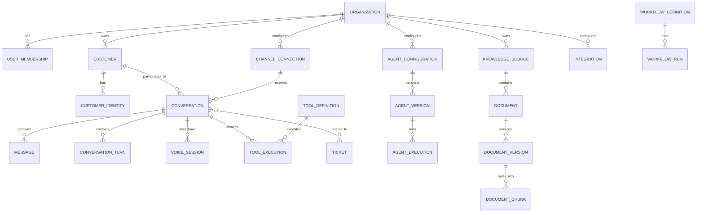

# 05 — Domain Model

## Core aggregate boundaries

- **Organization:** tenant boundary and configuration owner.
- **Conversation:** durable interaction and message timeline.
- **Customer:** profile and verified identity links.
- **Agent configuration/version:** published AI behavior and allowed capabilities.
- **Knowledge source/document version:** ingestion and retrieval lifecycle.
- **Tool execution:** authorization, idempotency, result, and audit.
- **Ticket:** support work item that can span conversations.
- **Voice session:** live media lifecycle linked to a conversation.
- **Workflow run:** deterministic multi-step execution.
- **Audit/usage event:** immutable record for governance and measurement.

## Relationship overview

## Data modeling rules

- All tenant-owned rows must include or be reachable through a trusted `organization_id`.
- Use internal UUIDs/ULIDs; keep provider IDs in separate fields with uniqueness scoped to provider/connection.
- Avoid using phone number/email as the primary key for a customer.
- Store timestamps in UTC; render local time at the edge.
- Keep external provider payloads only when needed for debugging/compliance and with explicit retention/redaction.
- Prefer immutable version rows for agent configuration, knowledge documents, workflows, and tool schemas.
- Keep messages, transcripts, audio references, and attachments distinct so retention/access policies can differ.
- Store object references rather than large binary payloads in the primary relational database.
- Record deletion and re-indexing propagation for knowledge sources.
- Do not store hidden chain-of-thought. Store concise decision metadata, tool calls, sources, and outcomes needed for debugging and audit.

## Suggested message kinds

- `text`
- `image_reference`
- `file_reference`
- `audio_reference`
- `system_event`
- `internal_note` (not customer-visible)
- `transcript_segment` (if transcript is modeled in the message timeline)

Use explicit visibility and direction fields rather than relying on message text conventions.
