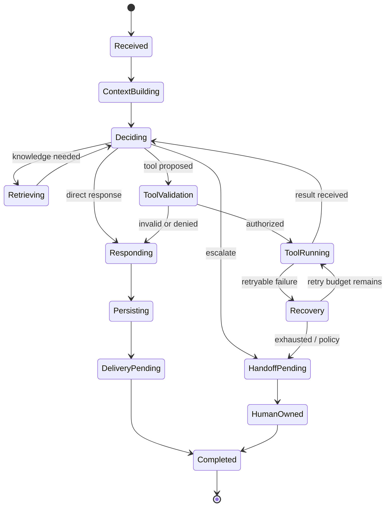

# 06 — AI Conversation Engine

## Responsibilities

The engine processes one customer turn and chooses among:
- answer from approved knowledge;
- ask a clarifying question;
- invoke an allowed business tool;
- create/update a ticket or workflow request;
- refuse or safely redirect a disallowed request;
- hand off to a human;
- recover from provider or tool failures.

## Recommended turn pipeline

1. Resolve trusted tenant, conversation, customer identity, and active agent version.
2. Check conversation state: open, closed, human-owned, rate-limited, or otherwise blocked.
3. Build a minimal context window from recent messages, a safe summary, and relevant structured state.
4. Classify intent/risk and identify missing information.
5. Retrieve approved knowledge when useful.
6. Plan the next step using only the agent's allowed tool registry.
7. Validate any proposed tool call against a schema and policy.
8. Execute authorized tool calls and validate returned data.
9. Generate a customer-facing response using verified results and source context.
10. Apply output safety and disclosure rules.
11. Persist final message, citations, tool results, timing, usage, and outcome metadata.
12. Emit events for delivery, evaluation, and analytics.

## State machine

## Prompt/context construction

Use explicit, separately labeled context sections:
- system-level behavior and non-negotiable policies;
- organization-approved agent instructions;
- customer-visible conversation history;
- trusted application state;
- retrieved source passages with source IDs;
- tool descriptions and JSON schemas;
- output format requirements.

Treat customer text, documents, retrieved content, and tool results as untrusted data. Instructions embedded in a retrieved document must not override system policy or tool permissions.

## Tool execution policy

- Allowlist tools per agent version and tenant.
- Validate argument schema before execution.
- Check tenant scope and user/customer authorization.
- Require confirmation or human approval for sensitive actions.
- Use idempotency keys for non-idempotent external operations where supported.
- Apply timeout, retry, and rate-limit policies.
- Return minimal, typed results to the model.
- Redact secrets and unnecessary personal data.
- Record outcome and audit metadata.

## Response policy

- Do not fabricate order status, account data, policies, or actions.
- Distinguish retrieved policy from live transactional data.
- If evidence is missing or contradictory, ask a question or escalate.
- Do not claim an action succeeded until the tool confirms success.
- Keep customer-facing responses concise and understandable.
- Support language selection and text/audio rendering separately from reasoning.

## Model-provider interface

Conceptual interface:
- `generate_response(input, output_schema, options)`
- `stream_response(input, options)`
- `classify(input, taxonomy, options)`
- `embed(texts, model_configuration)`
- optional `open_realtime_session(configuration)`

Keep vendor-specific request/response shapes in adapters. Capture model name/version, latency, usage, and provider errors without storing secrets.
