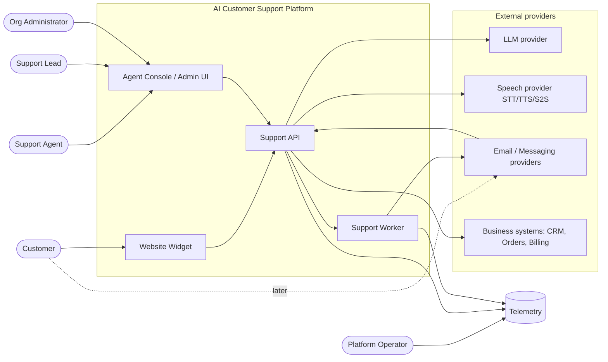
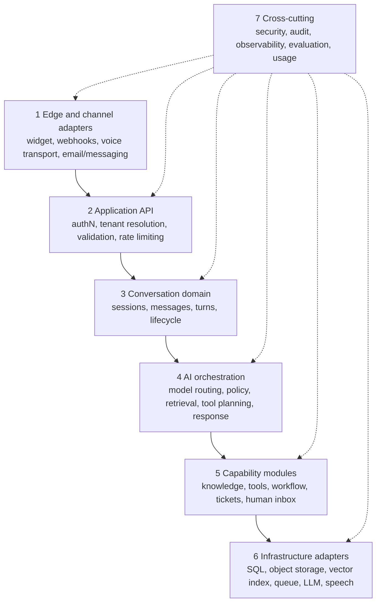
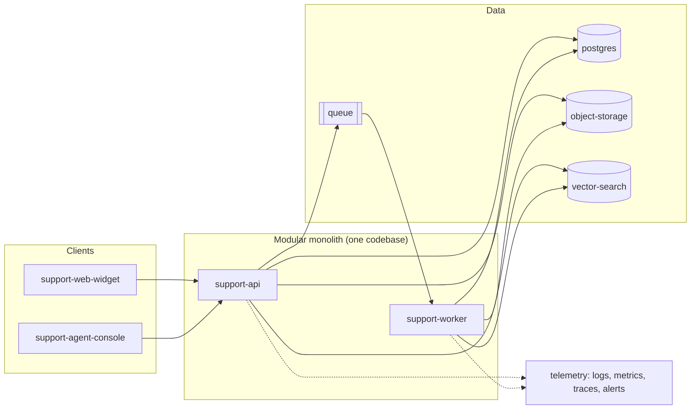
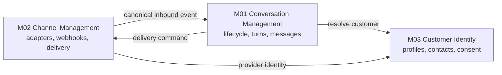
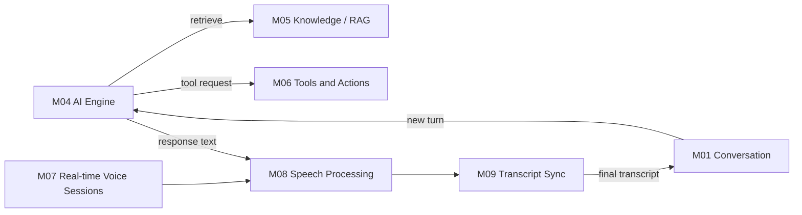
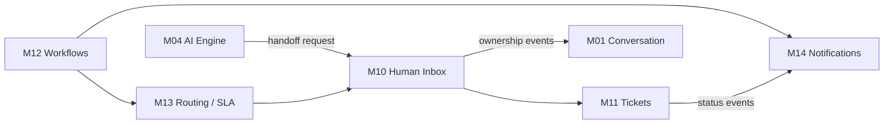
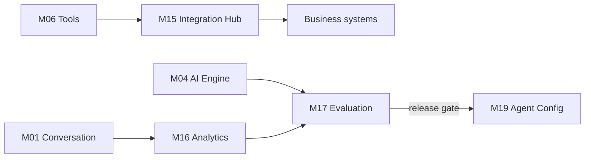
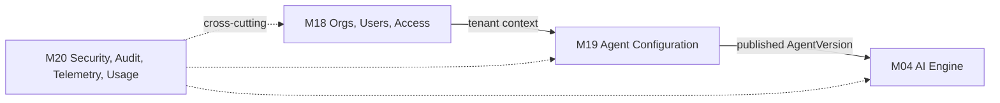
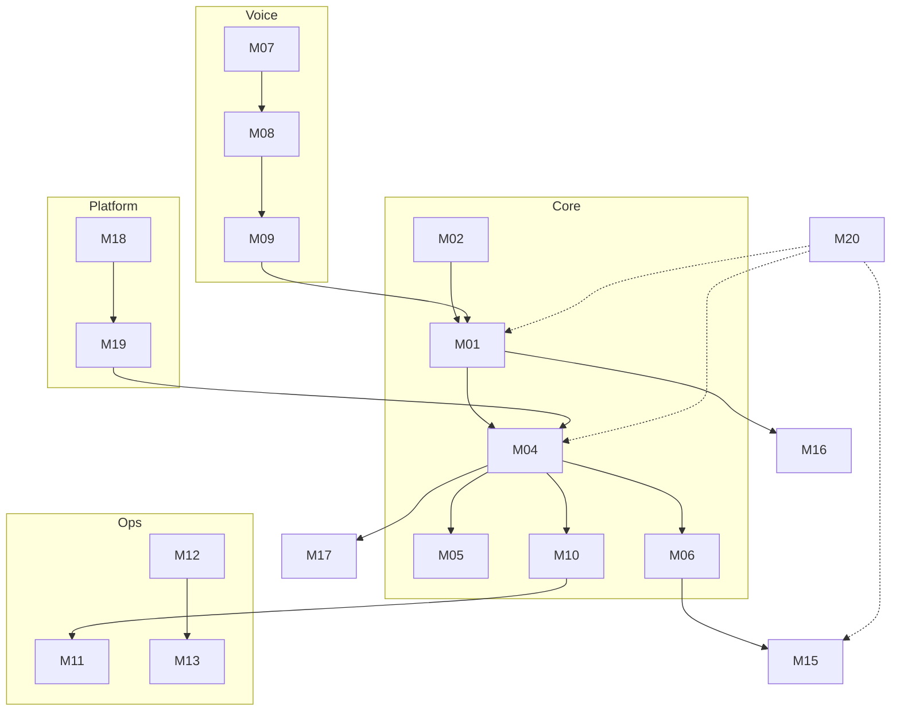
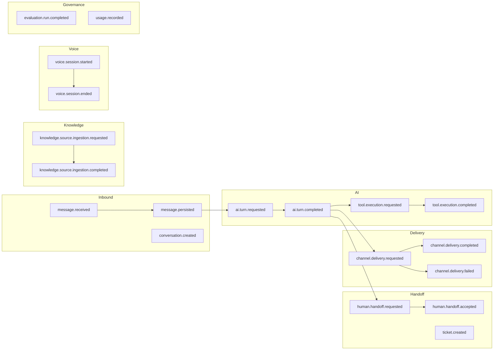

# 01 — Architecture Diagrams

Source: `03-system-architecture.md`, `02-module-catalog.md`, `04-module-communication.md`.
Large module map is split into five domain views (A–E) plus one combined dependency view.

## 1.1 System context

## 1.2 Logical layers

## 1.3 MVP deployable components

## 1.4 Module map — split by domain

### A. Customer interaction and conversation (M01–M03)

### B. AI conversation and voice (M04–M09)

### C. Support operations (M10–M14)

### D. Integrations and insights (M15–M17)

### E. Platform and governance (M18–M20)

## 1.5 Combined module dependency view

## 1.6 Event catalog by lifecycle

