# 02 — Cross-Cutting Flow Diagrams

Source: `04-module-communication.md`, `08-integrations-and-tools.md`, `09-security-privacy-reliability.md`.

## 2.1 Inbound webhook handling

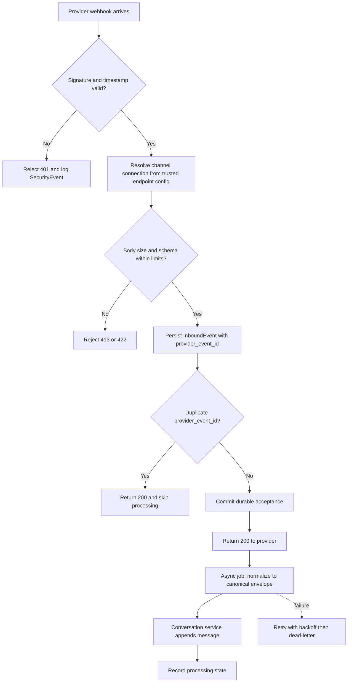

## 2.2 Transactional outbox and inbox

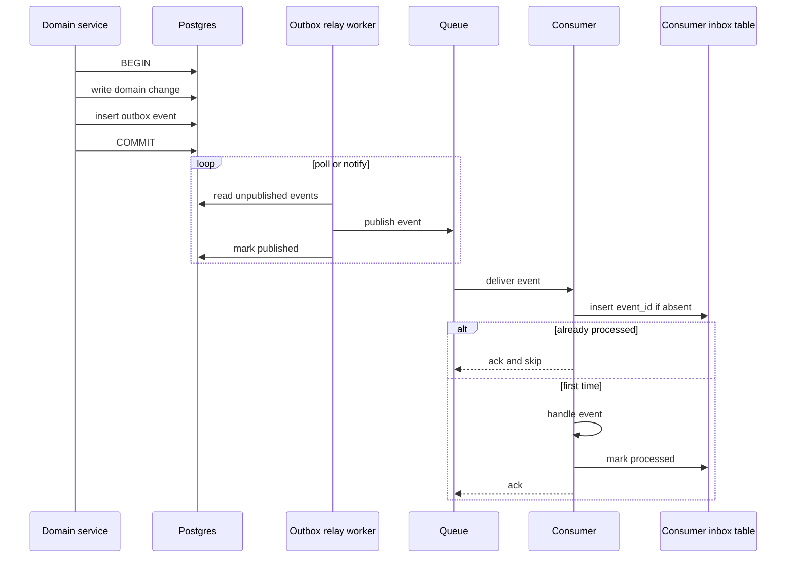

## 2.3 Outbound delivery state machine

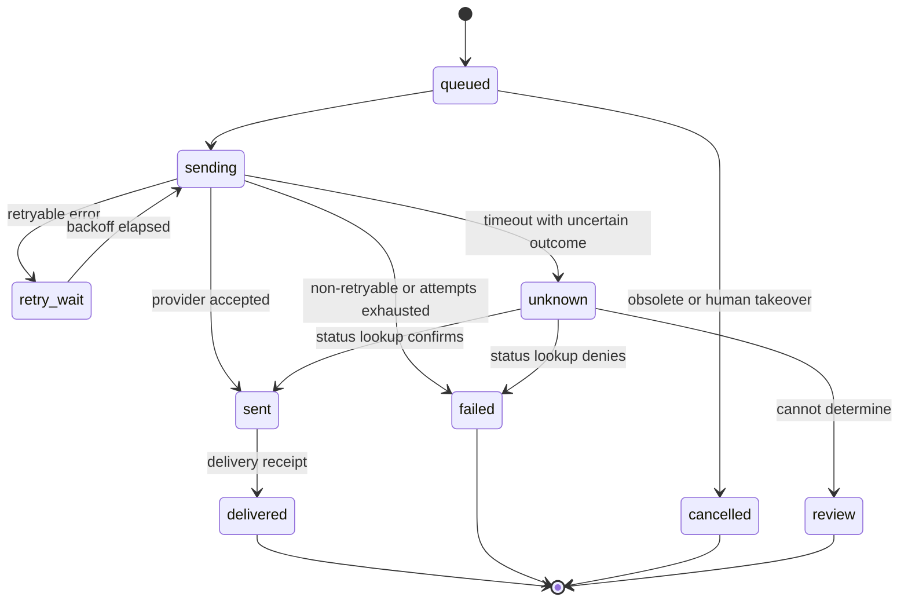

## 2.4 Retry decision

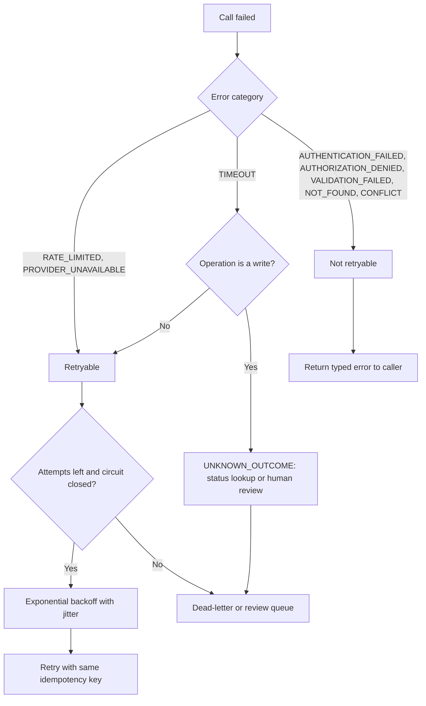

## 2.5 Tool execution — full pipeline (split in two parts)

### Part A: validation and authorization

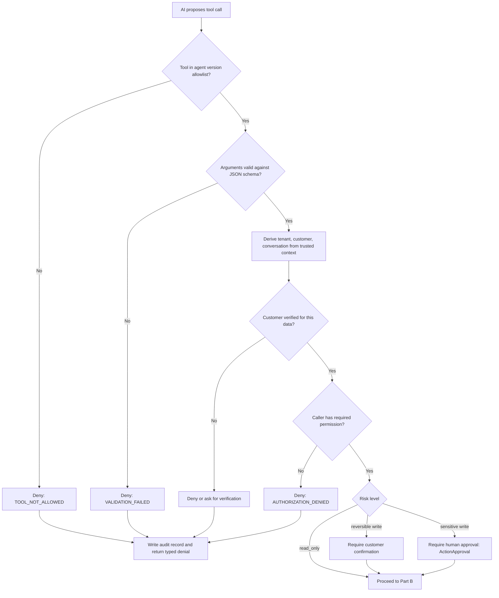

### Part B: execution and result handling

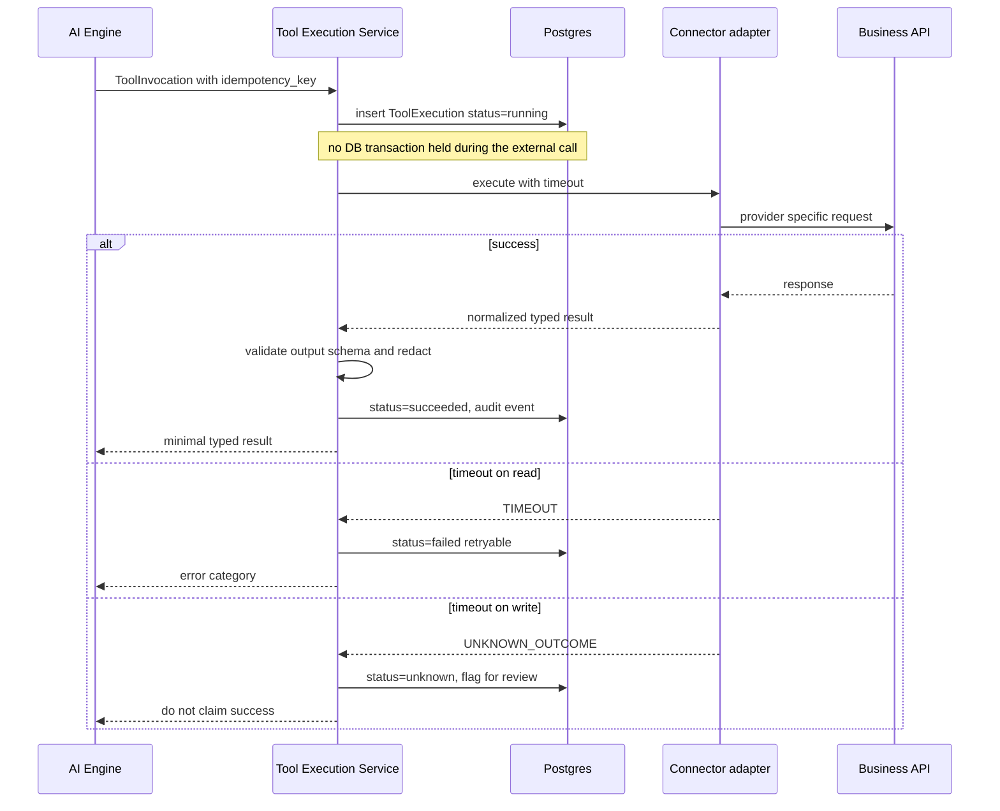

## 2.6 Tool execution state machine

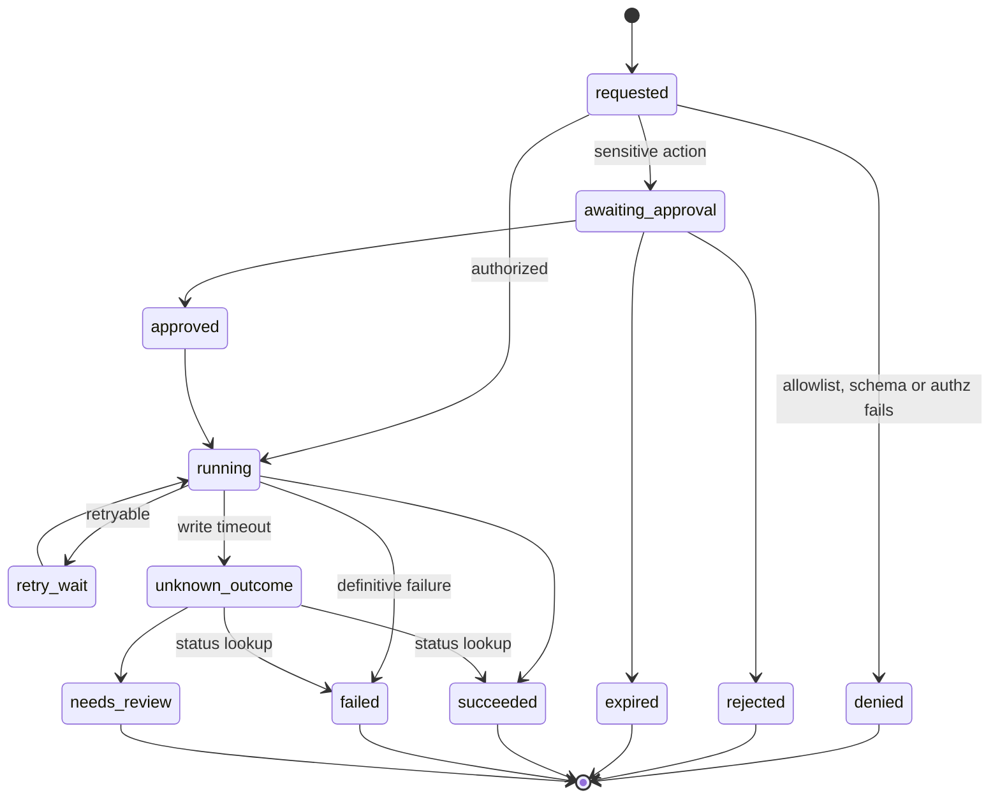

## 2.7 Tenant resolution and isolation

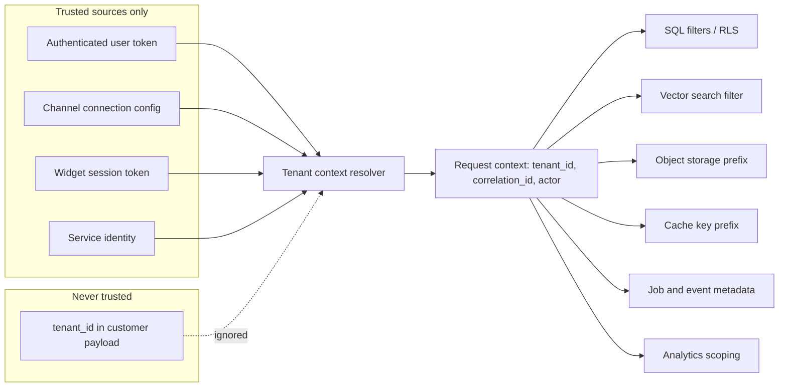

## 2.8 Secrets and credential flow

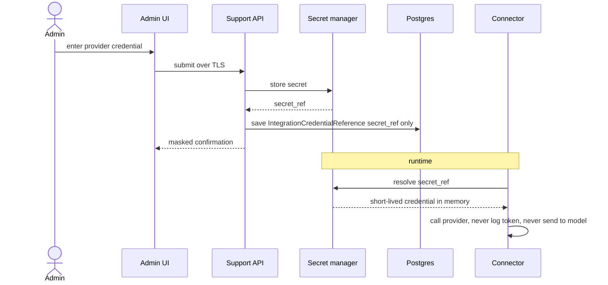

## 2.9 Graceful degradation

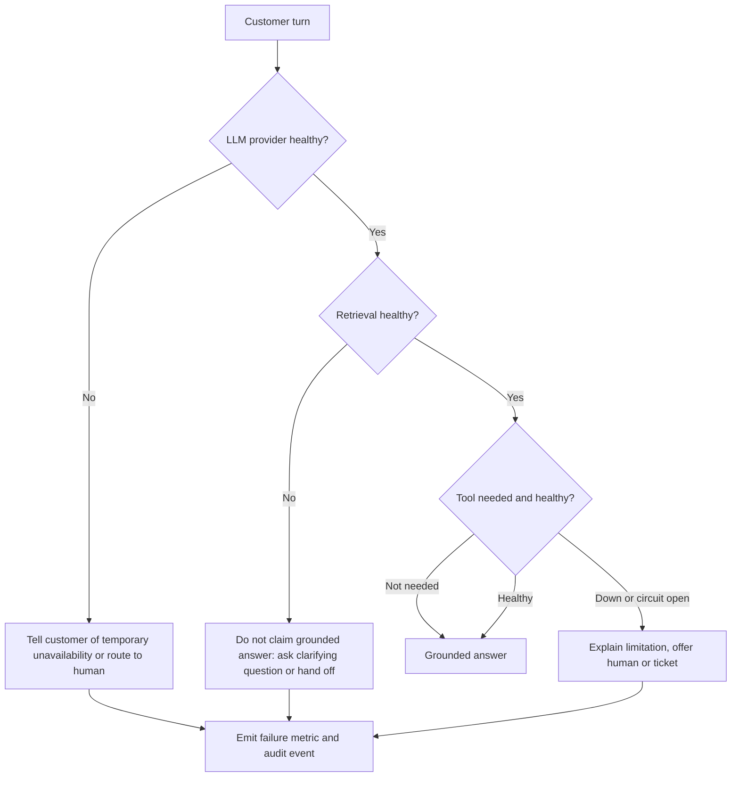

## 2.10 Data lifecycle and retention

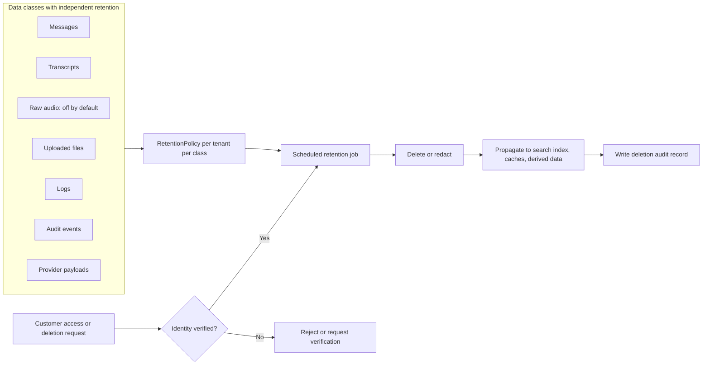

## 2.11 Security test matrix

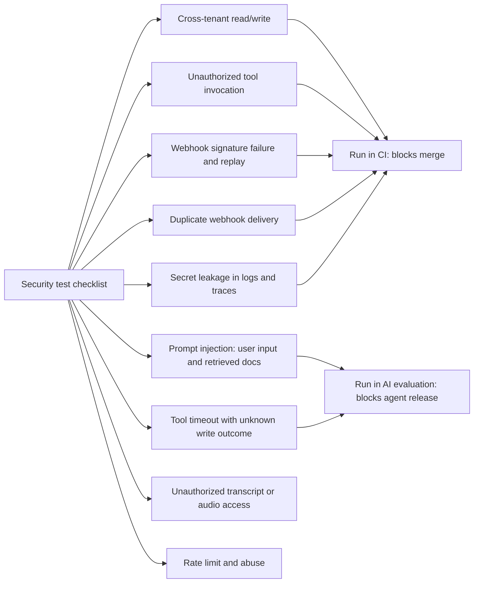
