# 03 — AI Conversation Engine Diagrams

Source: `06-ai-conversation-engine.md`. The 12-step turn pipeline is too big for one readable diagram, so it is split into four phases and then recombined as a state machine.

## 3.1 Turn pipeline overview

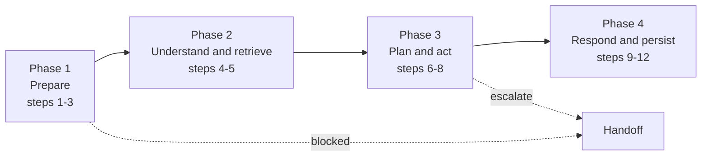

### Phase 1 — Prepare (resolve trust, check state, build context)

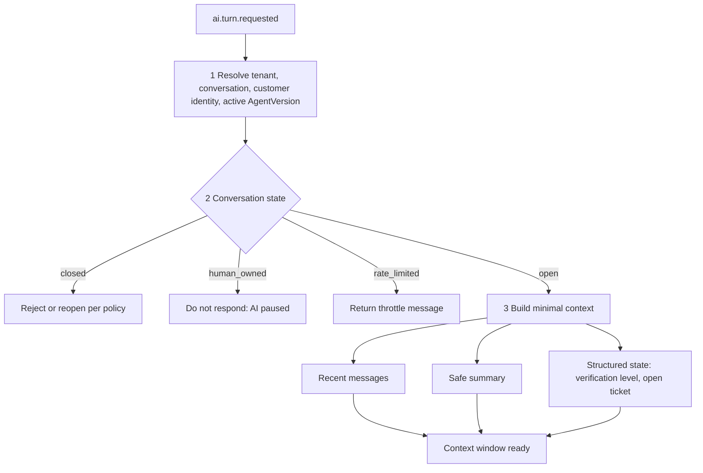

### Phase 2 — Understand and retrieve

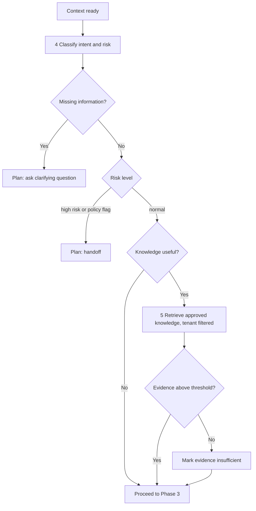

### Phase 3 — Plan and act (tool loop)

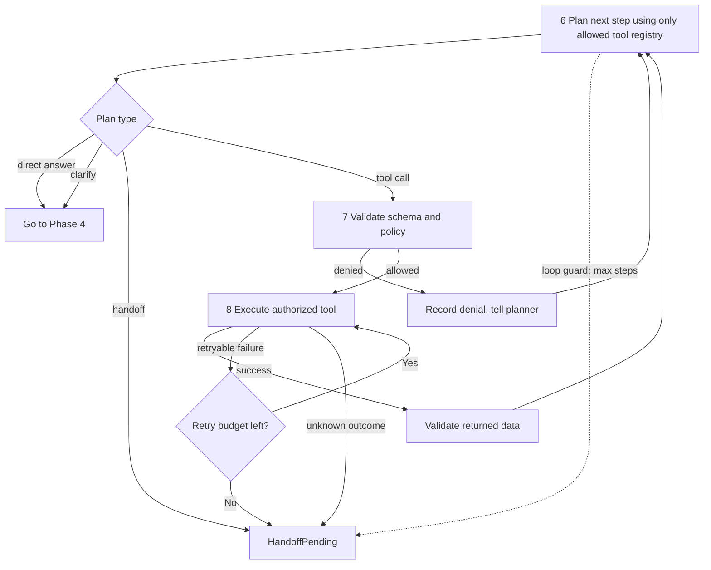

### Phase 4 — Respond and persist

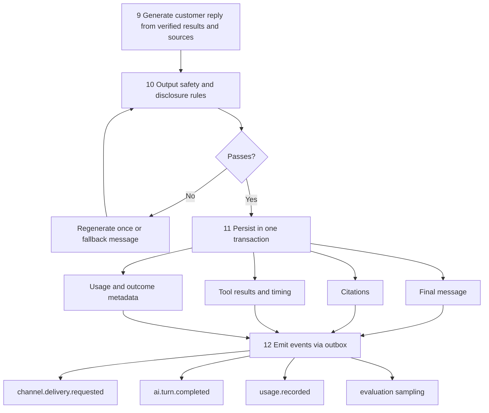

## 3.2 Turn state machine

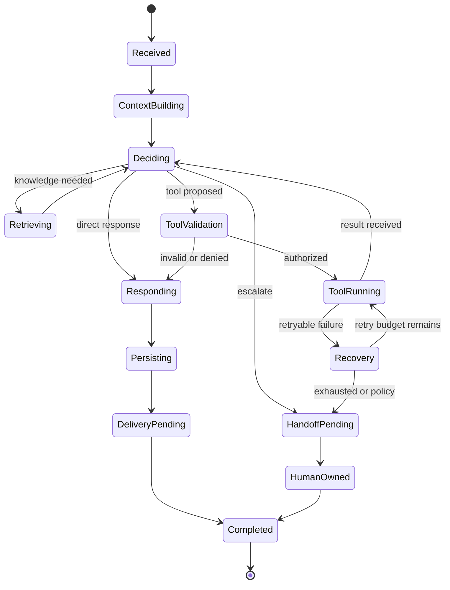

## 3.3 Context sections and trust levels

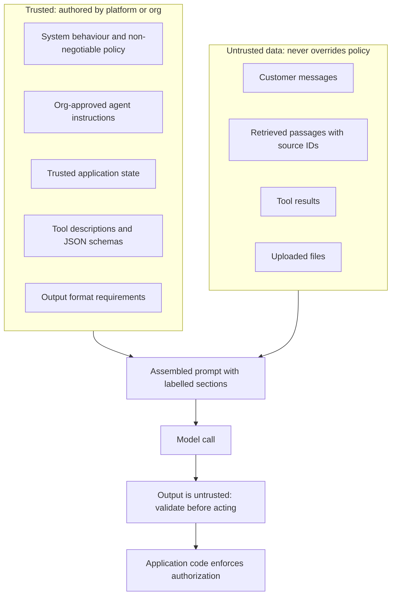

## 3.4 Escalation decision tree

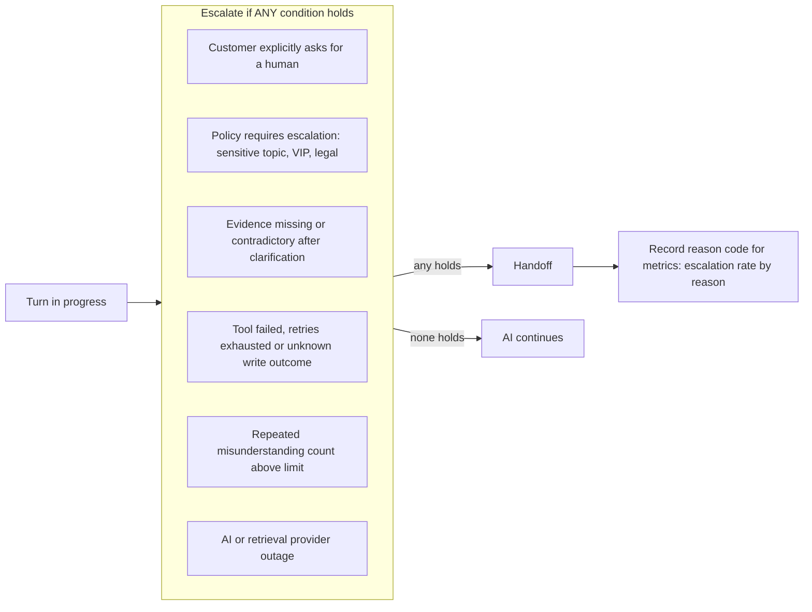

## 3.5 Response policy decision

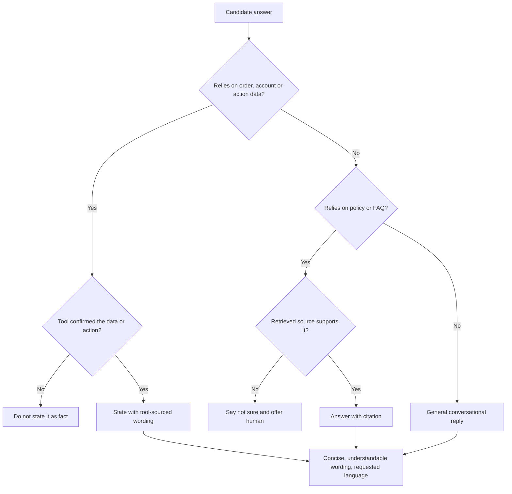

## 3.6 Model-provider adapter

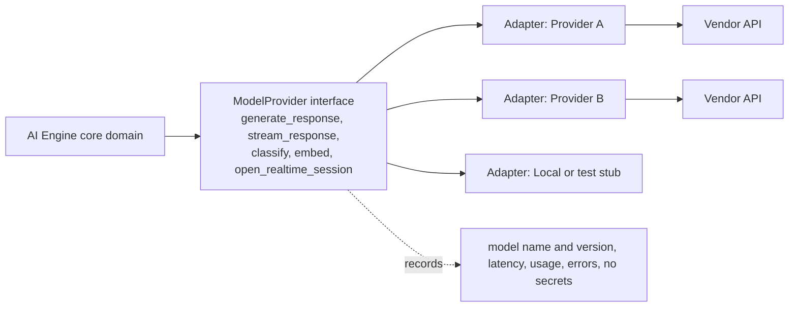

## 3.7 Agent version lifecycle (publish, rollback)

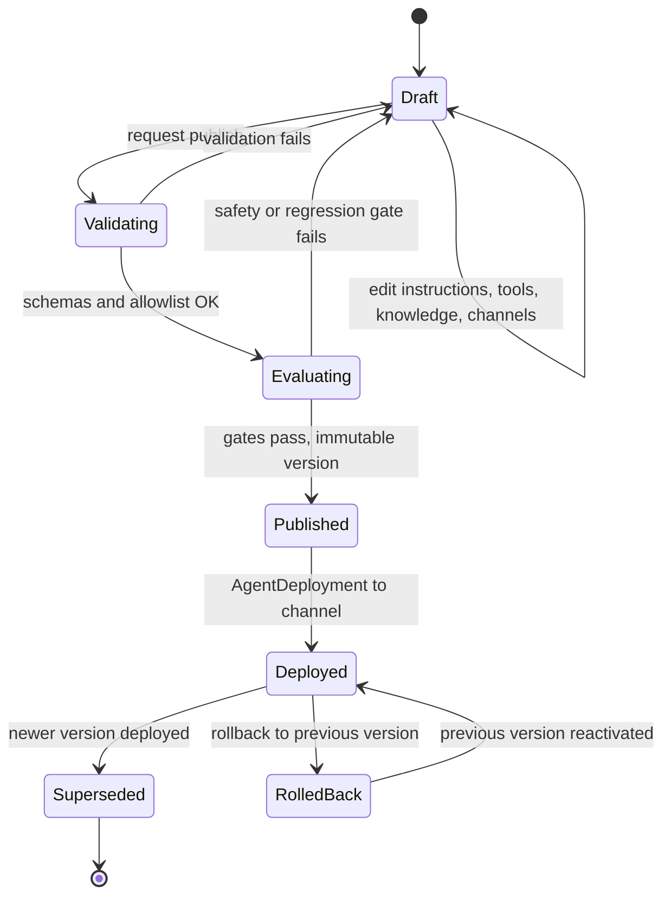

## 3.8 Failure handling inside a turn

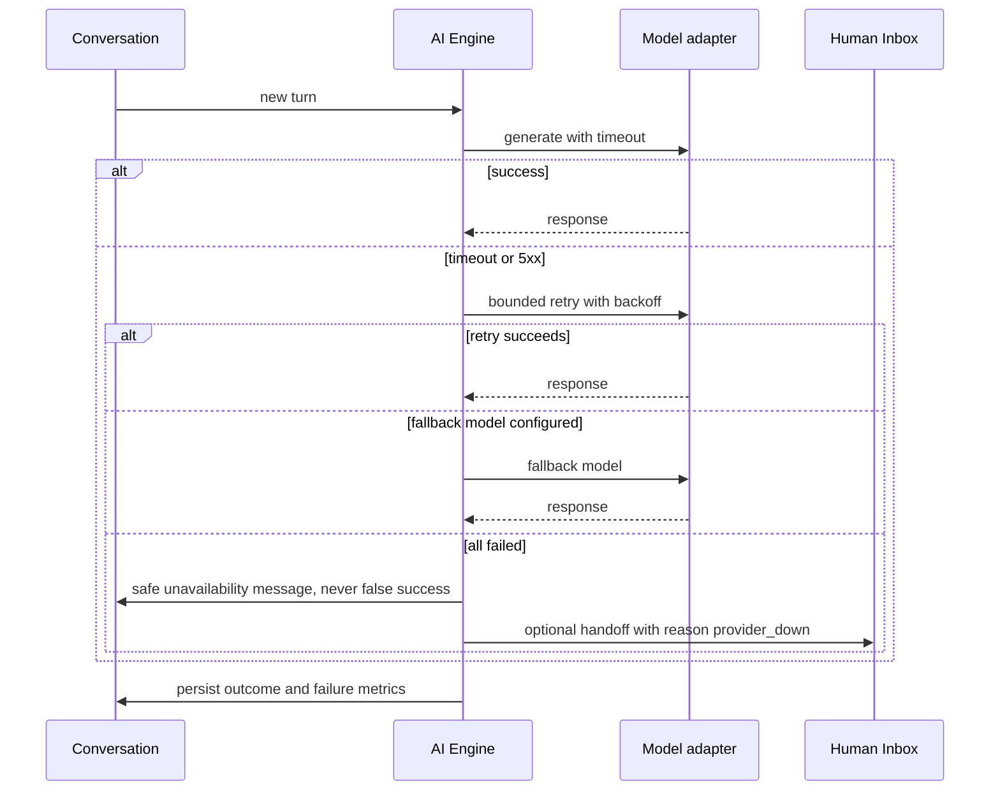
