# 04 — Voice and Multimodal Diagrams

Source: `07-voice-and-multimodal.md`, modules M07, M08, M09.

## 4.1 Voice session lifecycle

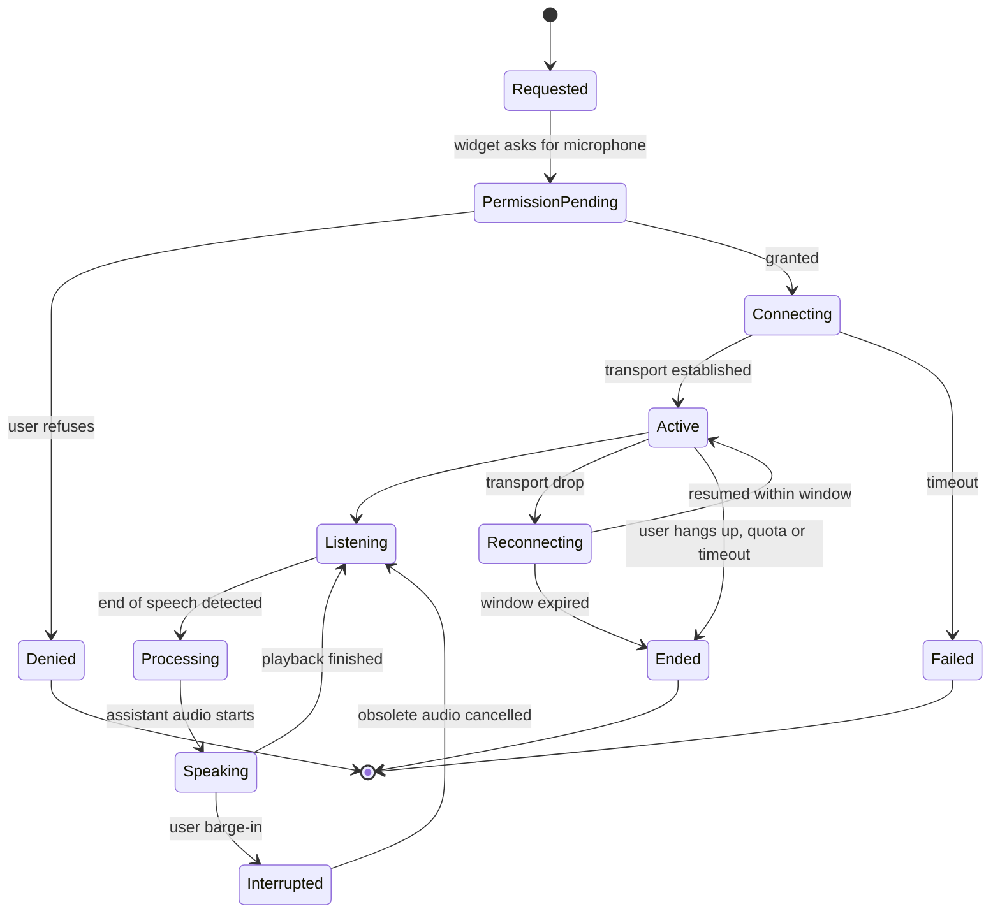

## 4.2 Two speech strategies

### Option A — modular pipeline

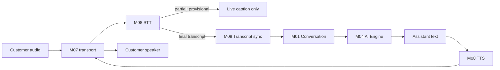

### Option B — speech-to-speech

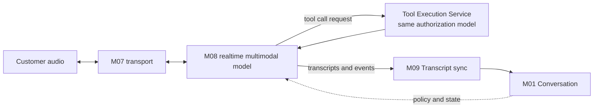

### Decision: which to start with

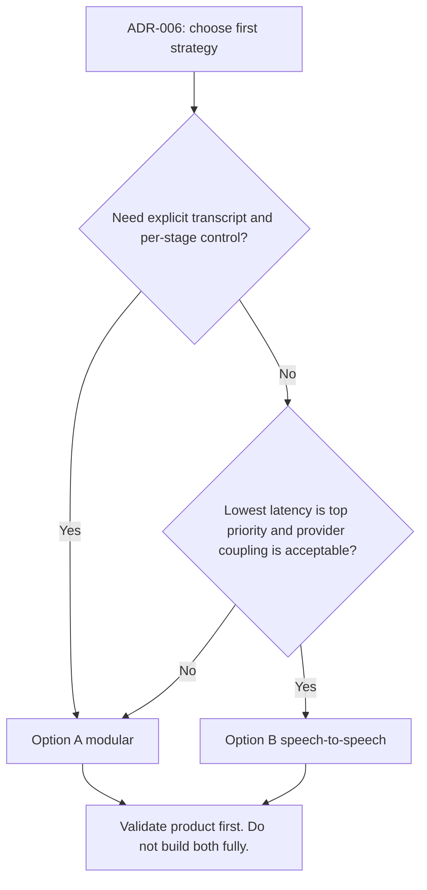

## 4.3 One voice turn (Option A) with persistence boundaries

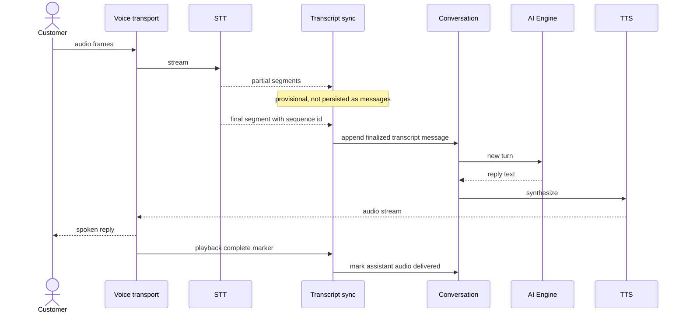

## 4.4 Interruption (barge-in)

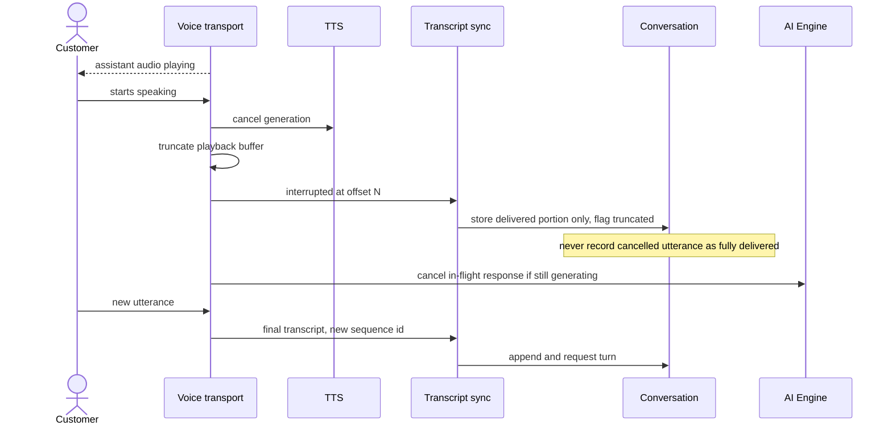

## 4.5 Partial vs final transcript handling

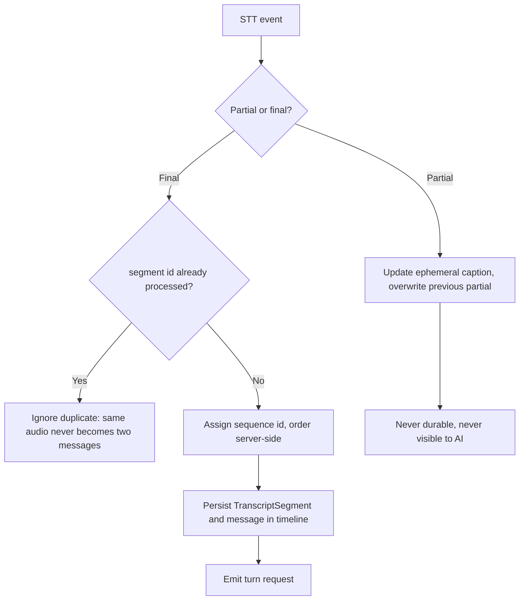

## 4.6 Modality switching in one conversation

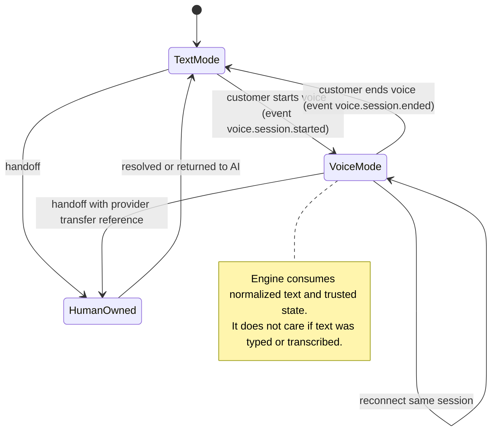

## 4.7 Voice handoff bundle

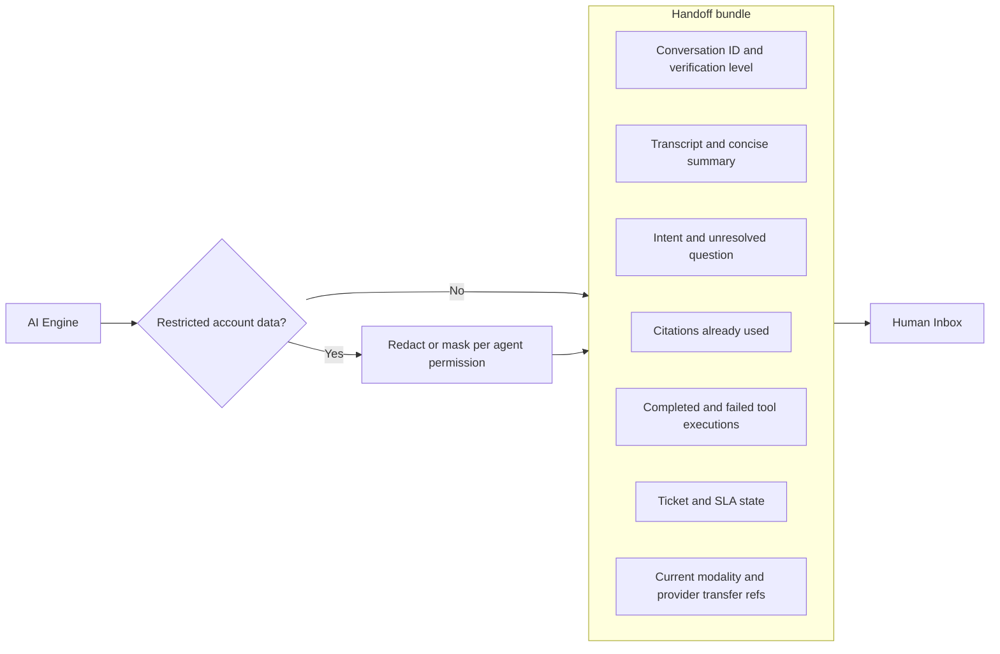

## 4.8 Voice privacy and consent

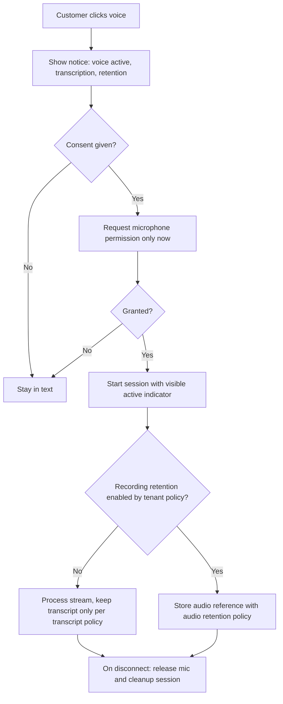

## 4.9 Voice metrics pipeline

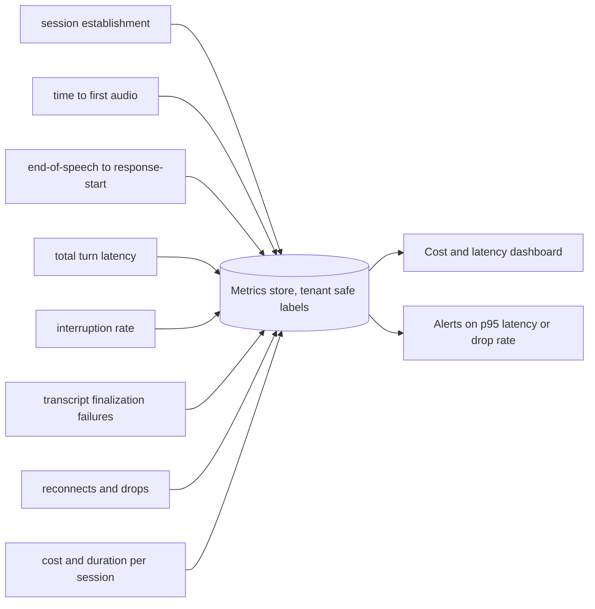
