# 05 — Data Model Diagrams (split by aggregate)

Source: `05-domain-model.md`, `02-module-catalog.md`. The single ER diagram in doc 05 is expanded into one diagram per aggregate group, with attributes. Attribute lists are illustrative.

## 5.0 Aggregate map

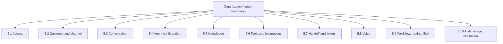

## 5.1 Organizations, users and access

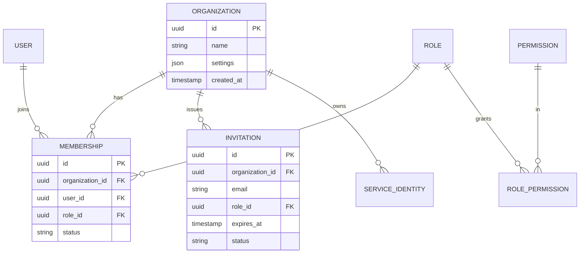

## 5.2 Customer and channel

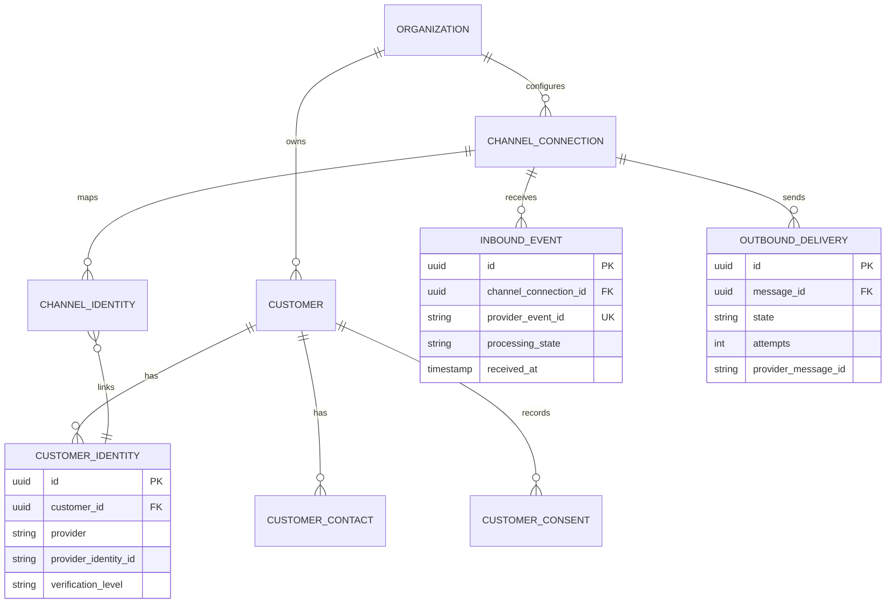

## 5.3 Conversation

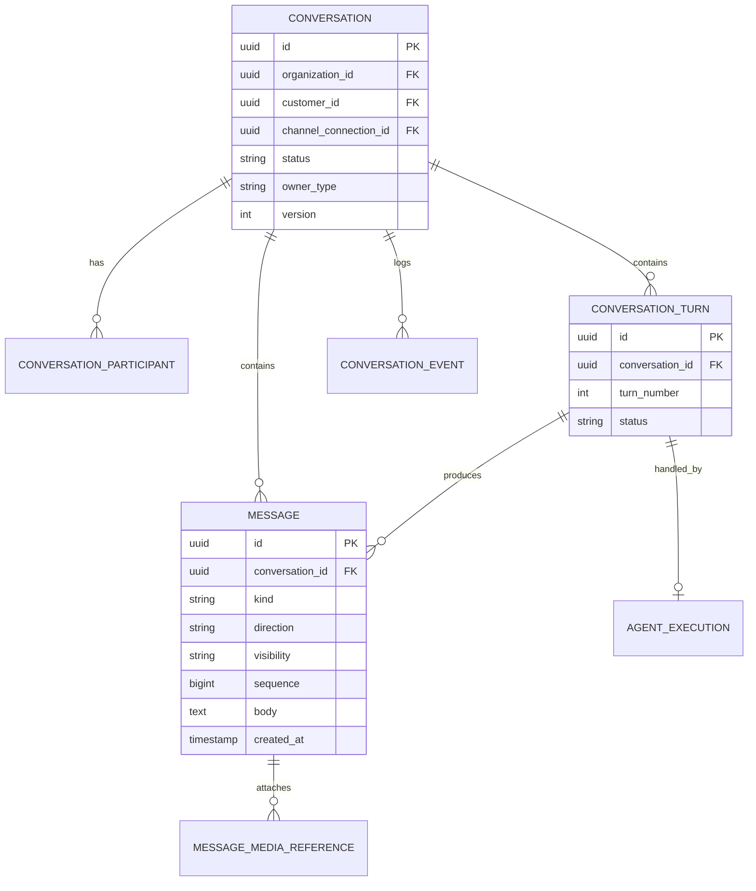

## 5.4 Agent configuration and execution

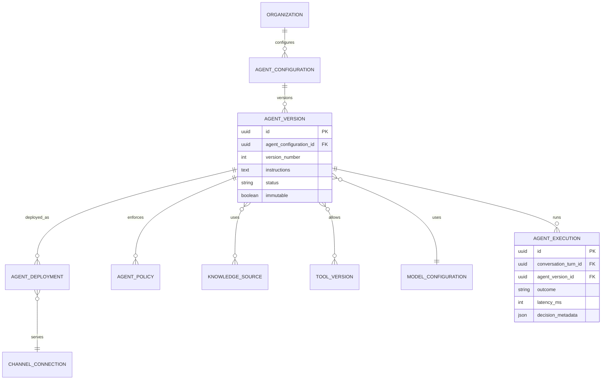

## 5.5 Knowledge

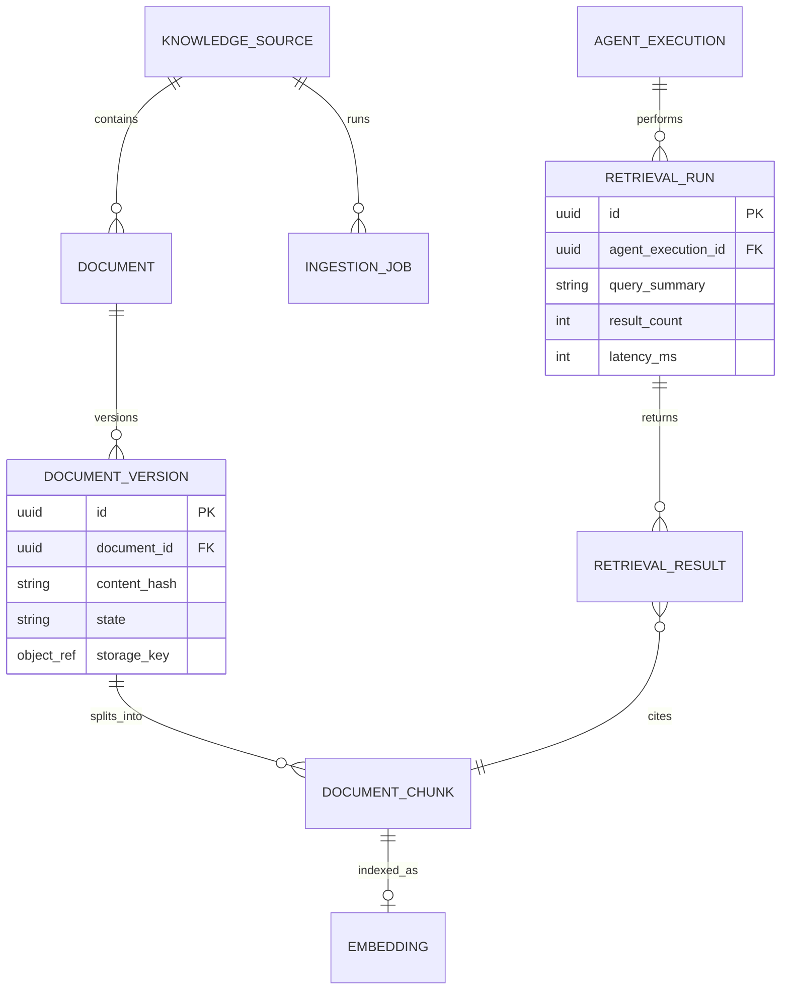

## 5.6 Tools and integrations

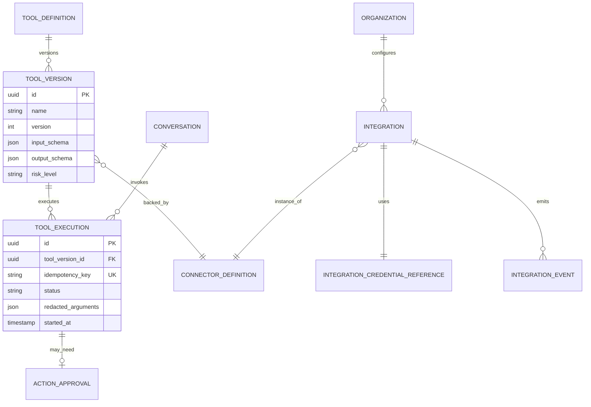

## 5.7 Handoff and tickets

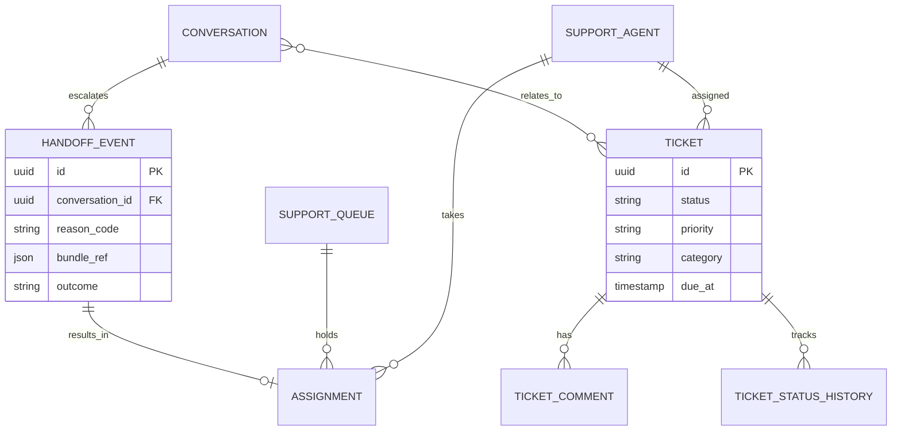

## 5.8 Voice

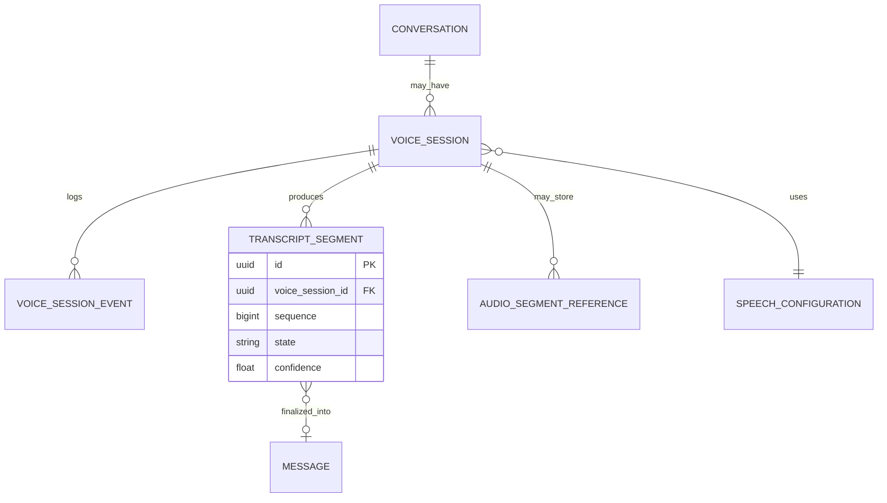

## 5.9 Workflow, routing and SLA

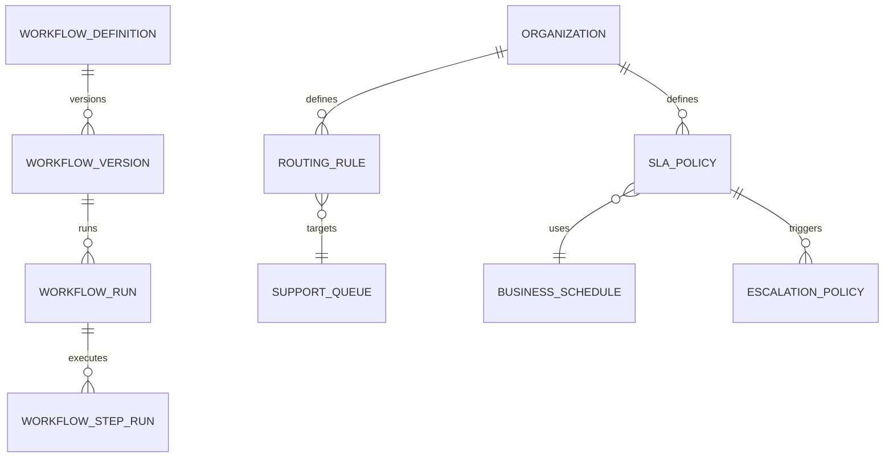

## 5.10 Audit, usage and evaluation

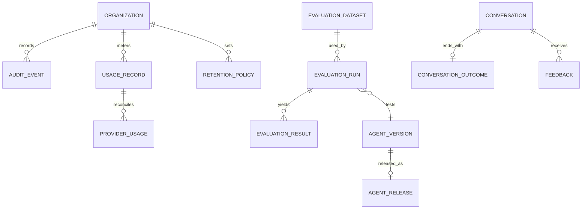
