# 06 — Sprint Diagrams

Source: `scrum/02-sprint-plan.md`. Sprint length is assumed to be two weeks. The plan is a hypothesis, to be re-forecast after Sprint 1.

## 6.1 Sprint sequence and goals

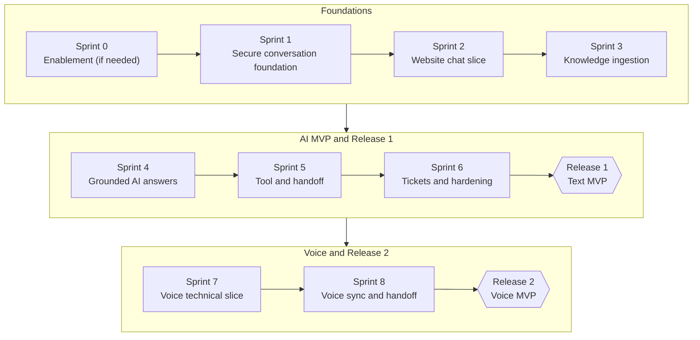

## 6.2 Increment growth: what the demo can show after each sprint

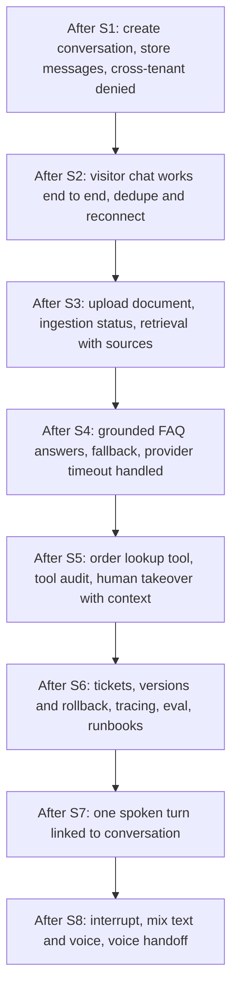

## 6.3 Gantt (placeholder dates)

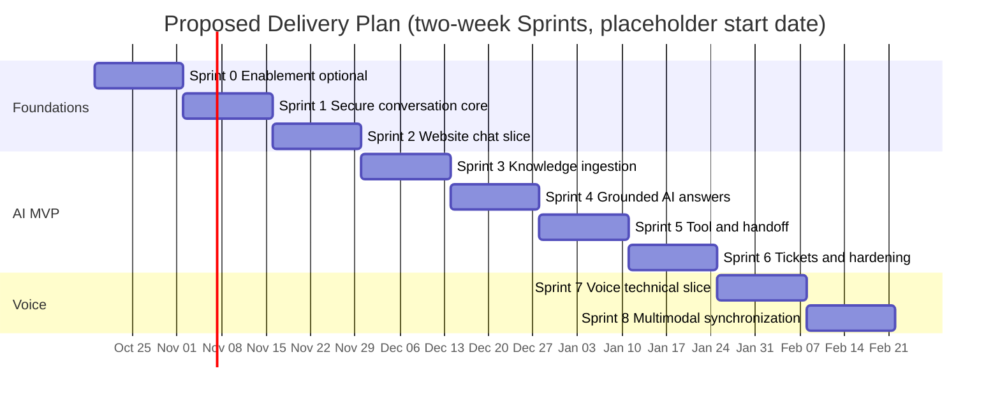

## 6.4 Per-sprint detail

### Sprint 0 — Enablement

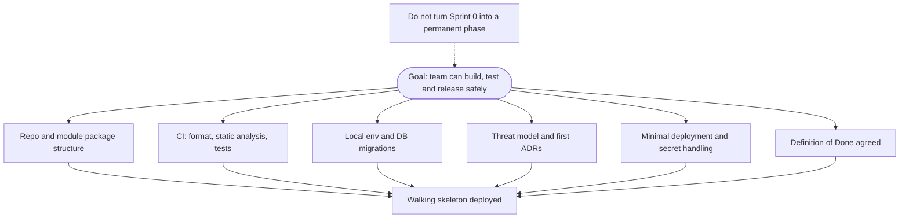

### Sprint 1 — Secure conversation foundation

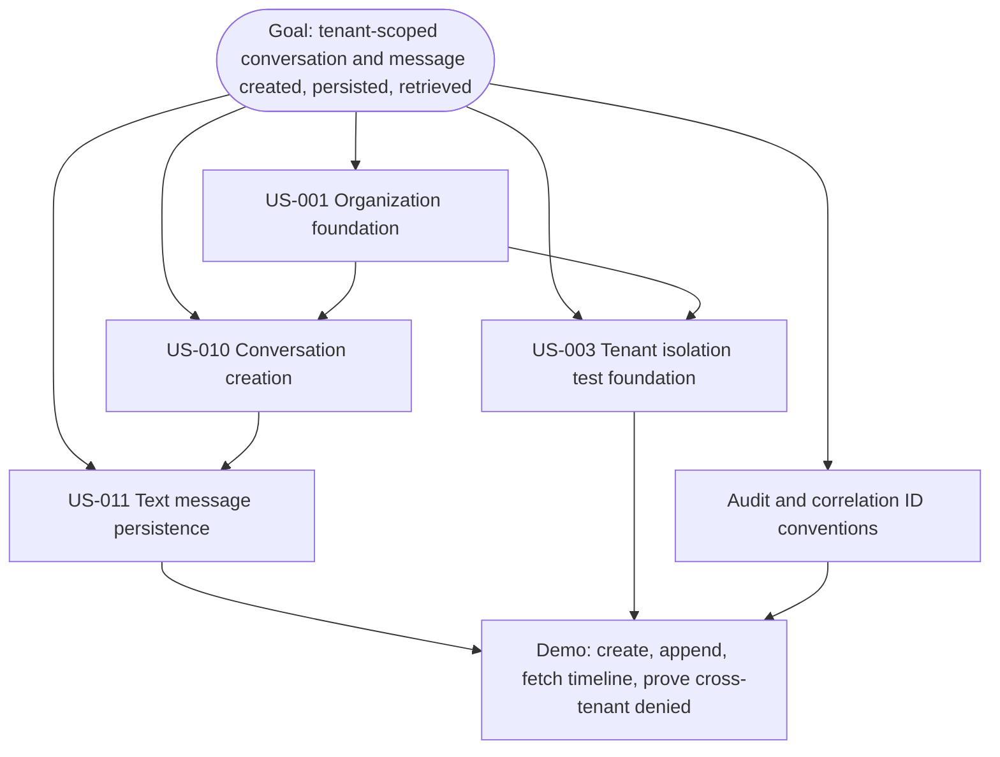

### Sprint 2 — Website chat vertical slice

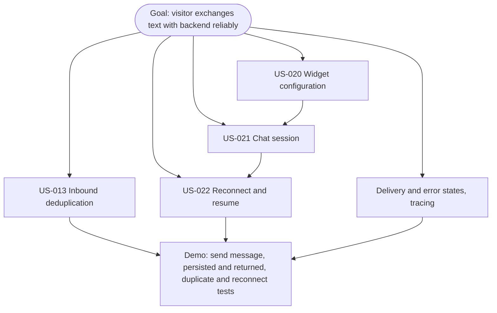

### Sprint 3 — Knowledge ingestion and retrieval

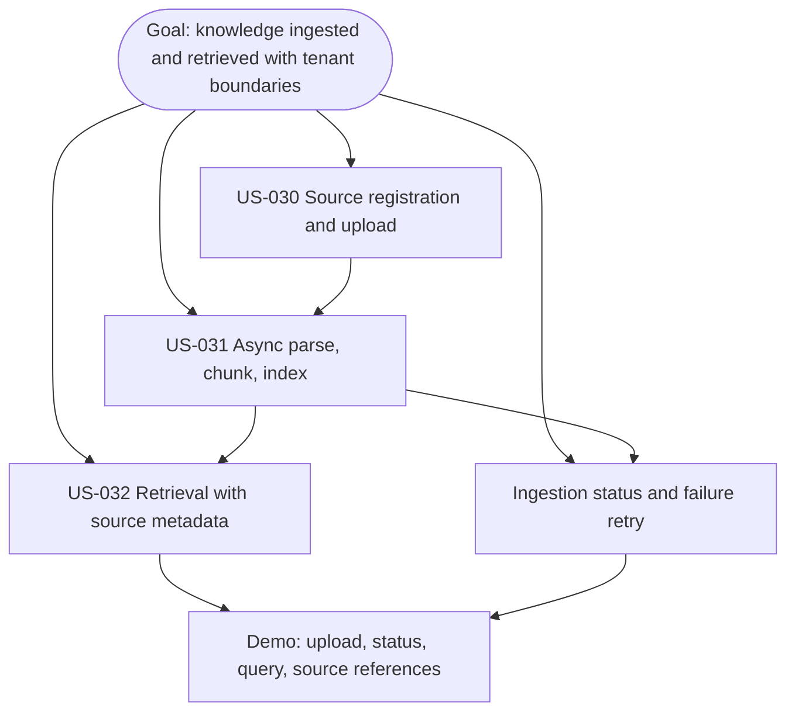

### Sprint 4 — Grounded AI answers

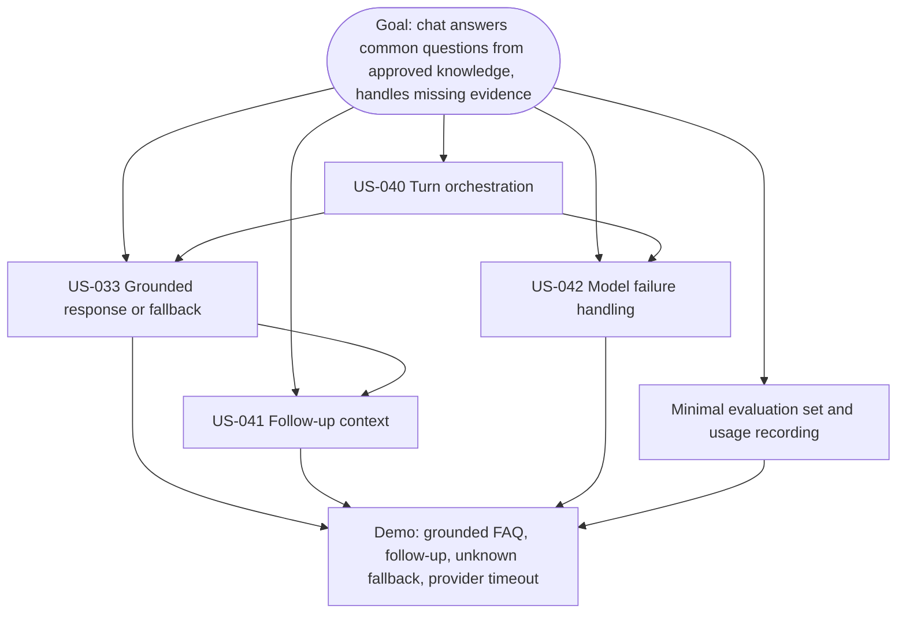

### Sprint 5 — Safe business tool and human handoff

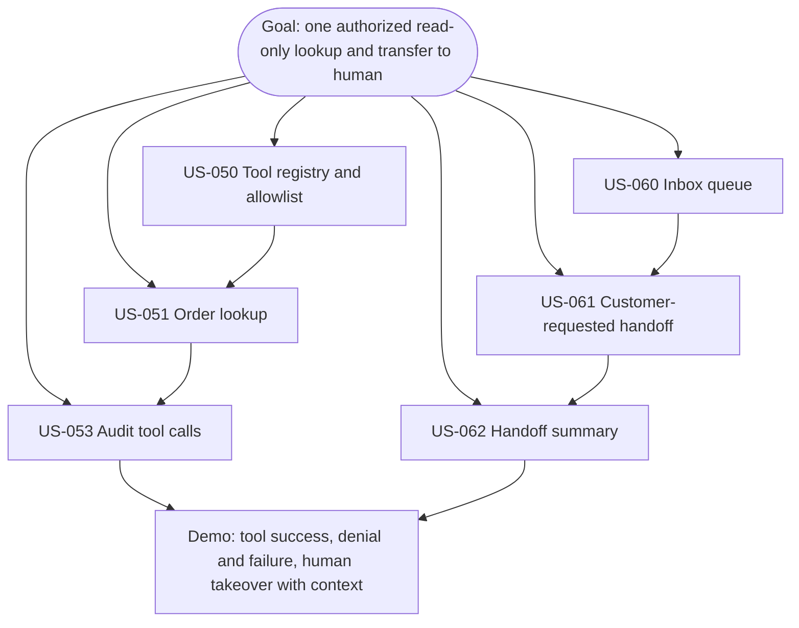

### Sprint 6 — Tickets and release hardening

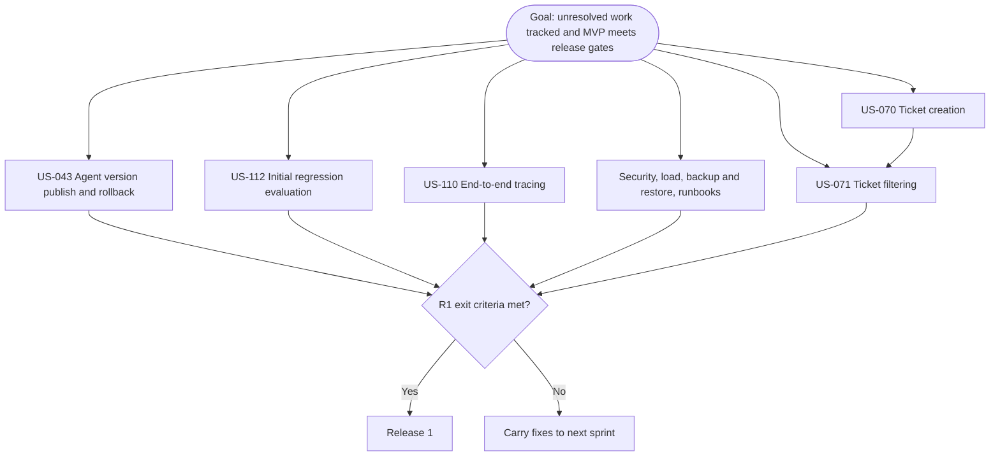

### Sprint 7 — Voice technical spike and slice

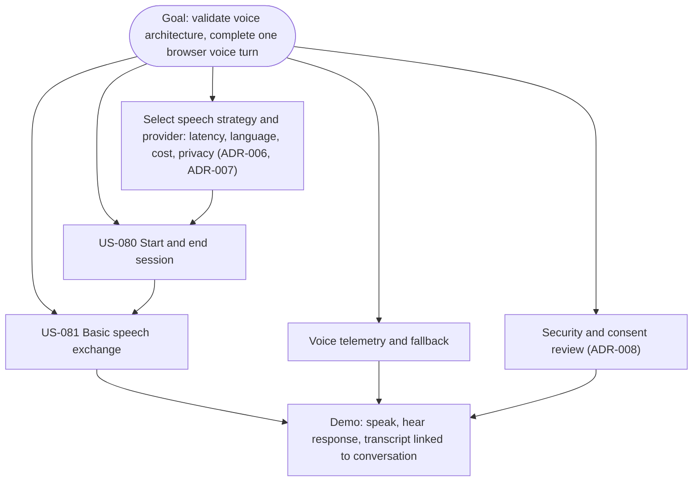

### Sprint 8 — Voice synchronization and handoff

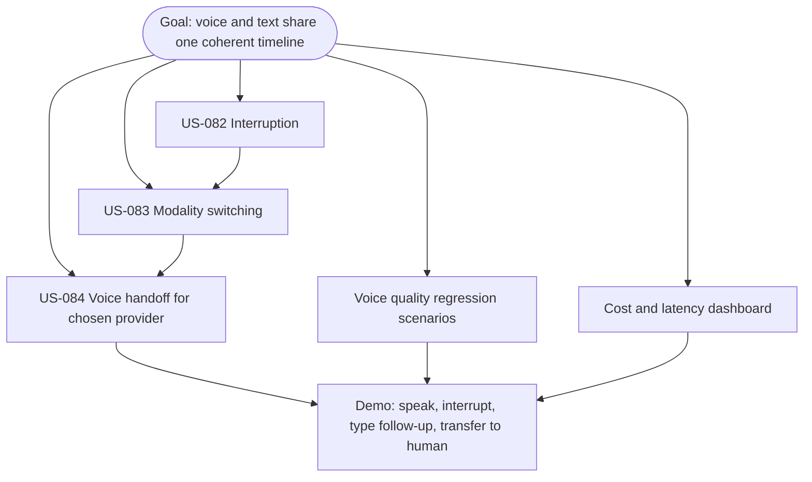

## 6.5 Story to sprint traceability

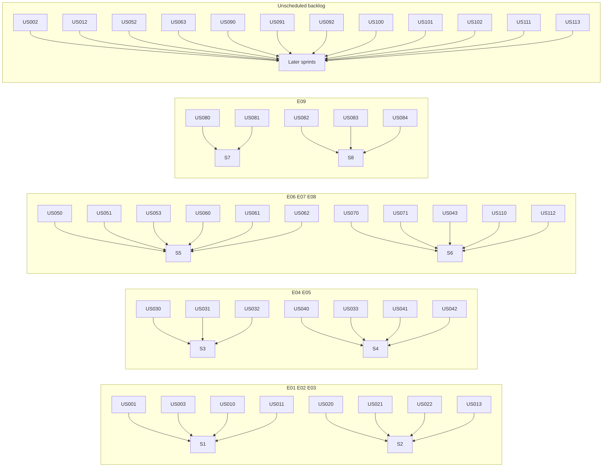

Stories without an explicit sprint in the plan (US-002, US-012, US-052, US-063, US-090 to US-092, US-100 to US-102, US-111, US-113) are flagged above as unscheduled. Several are needed by the Release 1 exit criteria (US-052 timeout safety, US-063 resolve, US-012 timeline view, US-002 user invitations) and should be pulled into Sprints 1 to 6 during refinement.
