# 07 — Scrum, Release and Risk Diagrams

Source: `scrum/00` to `scrum/06`. These extend the 8 diagrams already in `scrum/05-mermaid-artifacts.md`, which are not repeated here.

## 7.1 Scrum roles and accountabilities

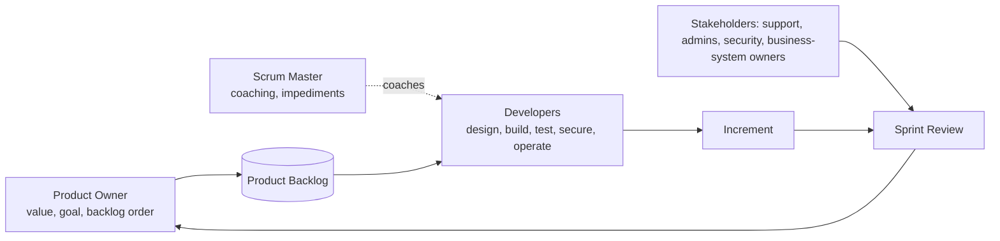

## 7.2 Scrum events within a sprint

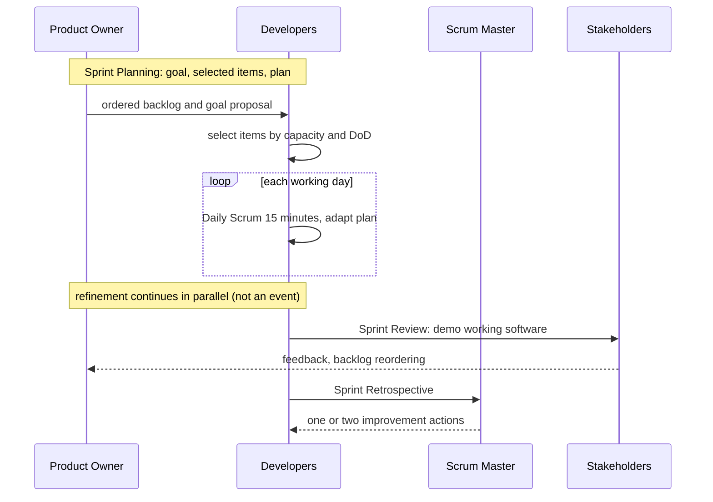

## 7.3 Definition of Ready check

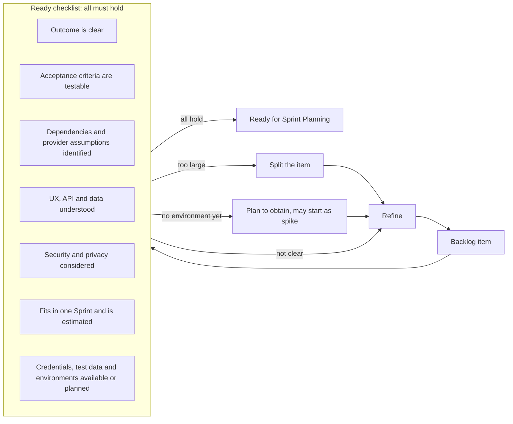

## 7.4 Definition of Done layers

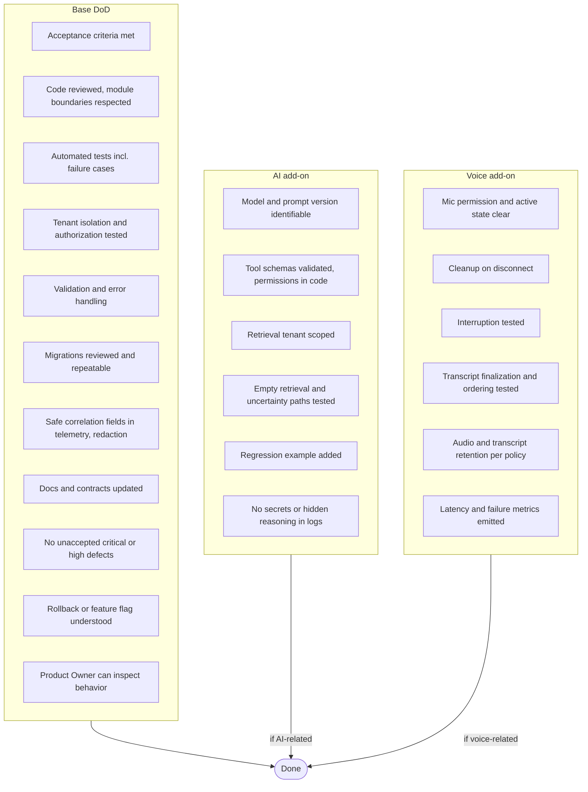

## 7.5 Release exit criteria

### Release 1 — Text MVP

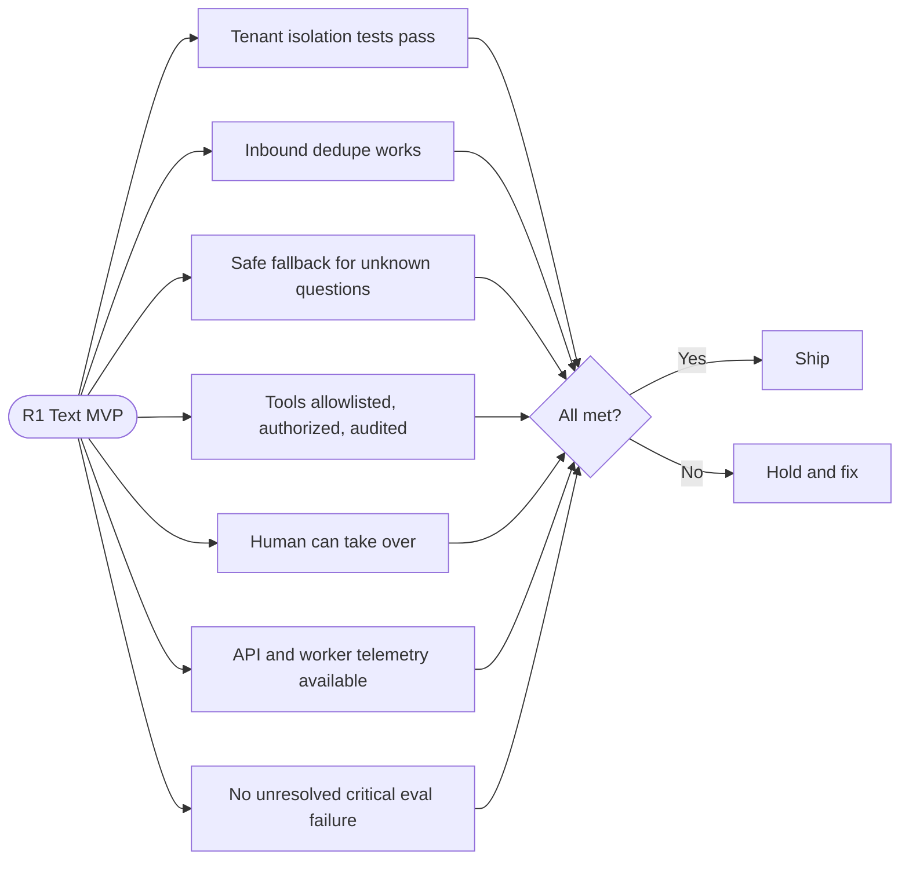

### Release 2 — Voice MVP

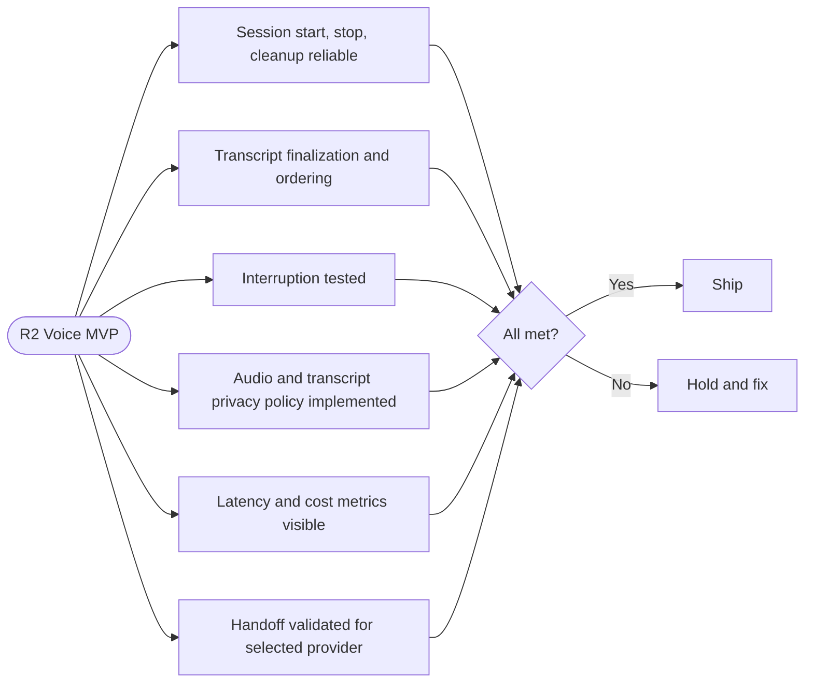

## 7.6 Rollout and rollback

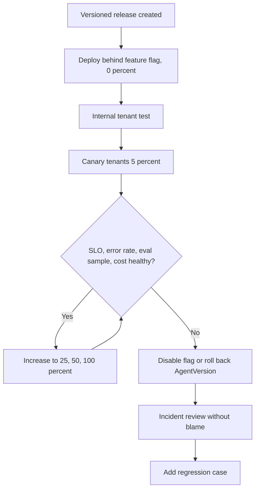

## 7.7 Risk map

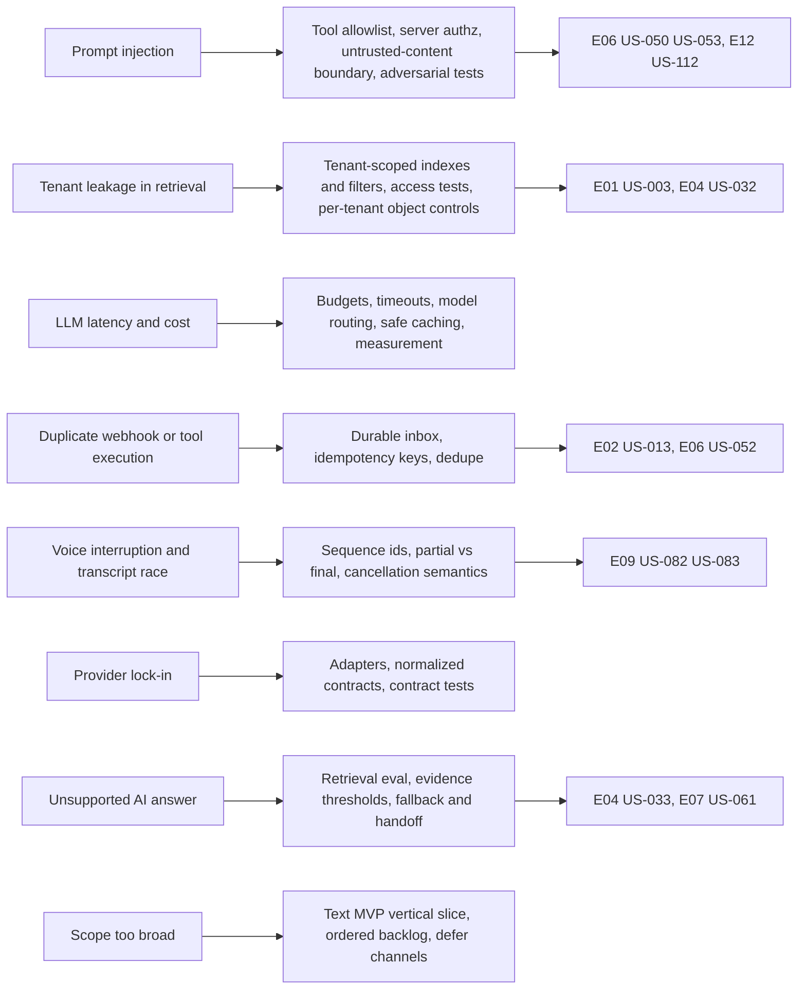

## 7.8 ADR dependency order

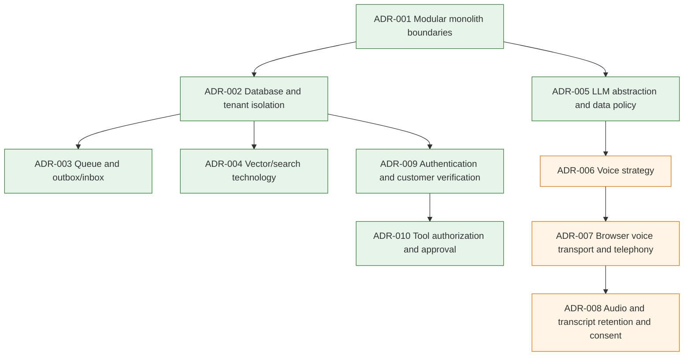

## 7.9 Decisions to defer

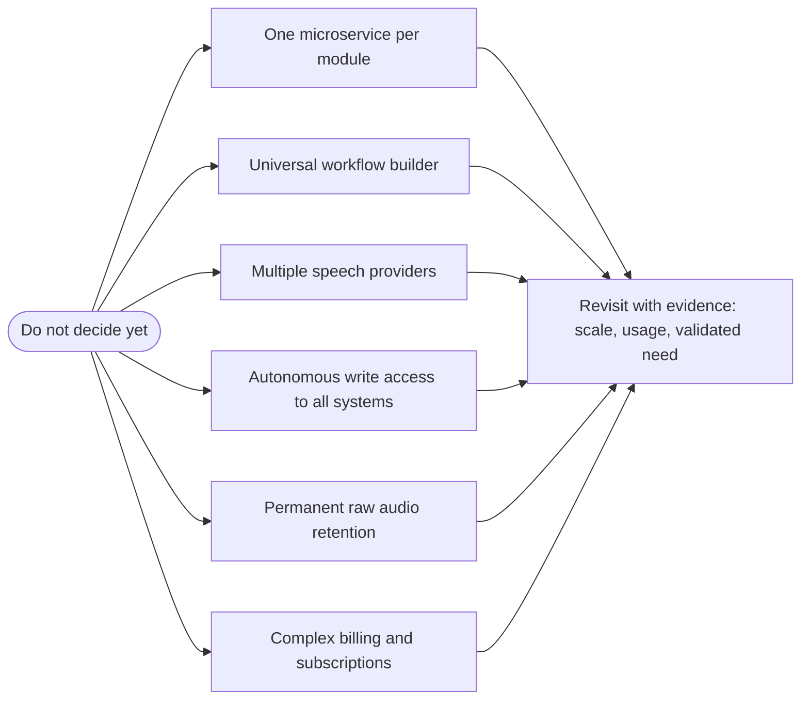

## 7.10 Epic delivery map by release

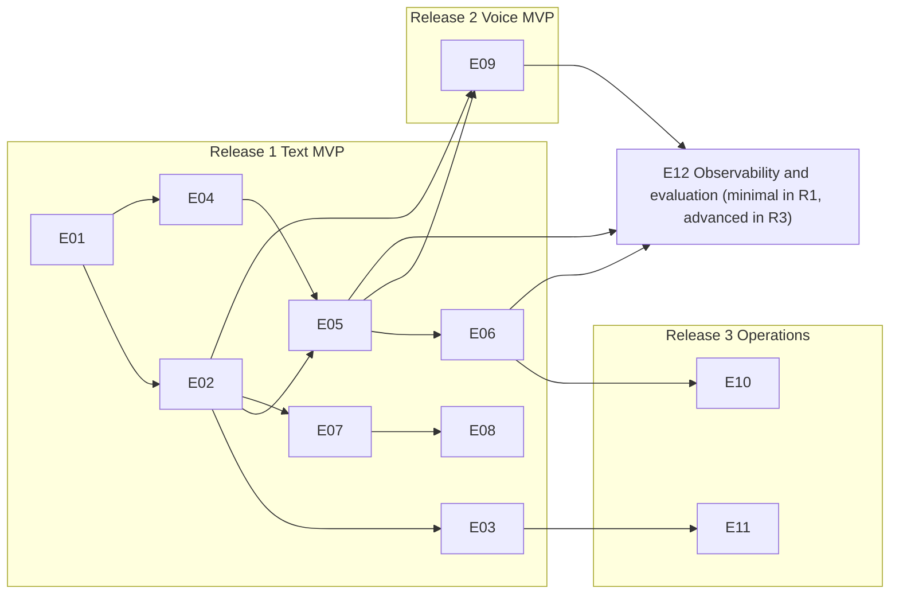
