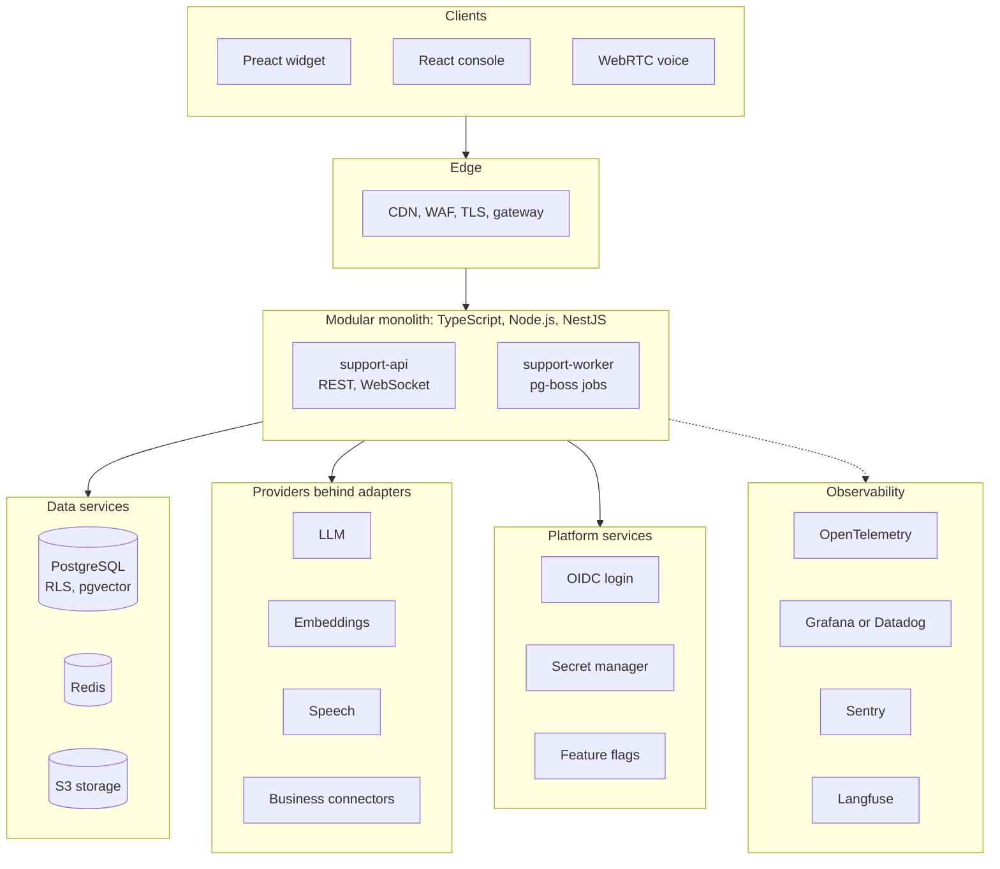
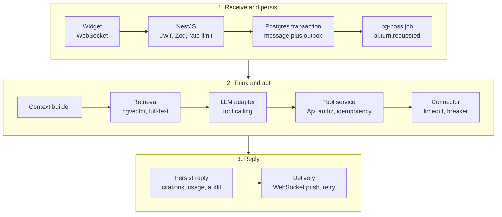
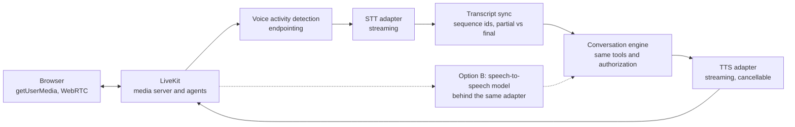
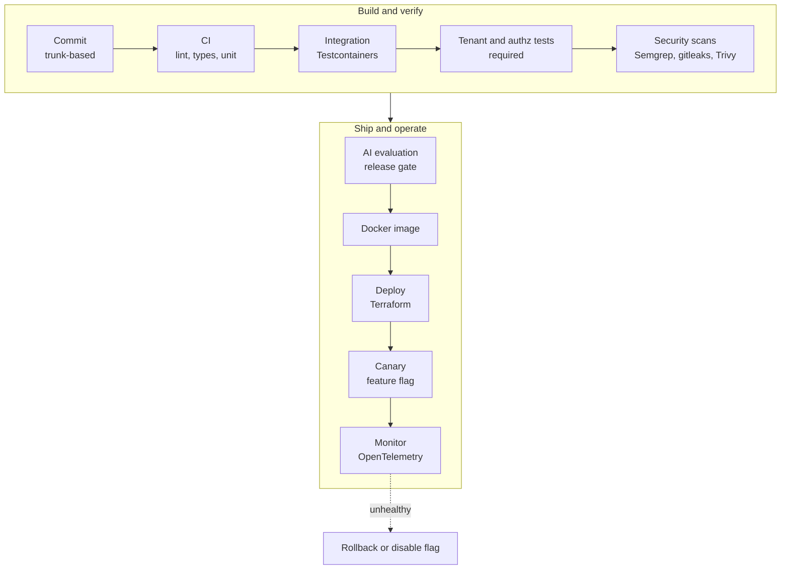
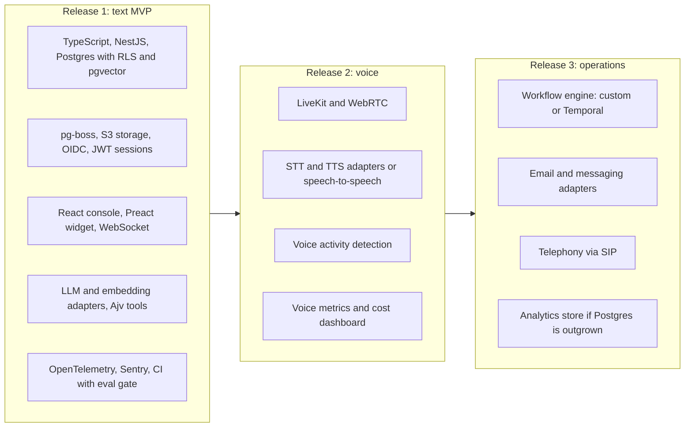

# 08 — Technology Diagrams

Source: `11-technology-stack.md`, `12-technology-by-task.md`, `13-technology-decisions.md`. These show the proposed default stack. Provider-specific parts sit behind adapters, so any box marked with several options can change without touching the core domain.

## 8.1 Technology stack map

## 8.2 A customer message through the stack

## 8.3 Voice stack

## 8.4 Delivery toolchain

## 8.5 When each technology arrives

