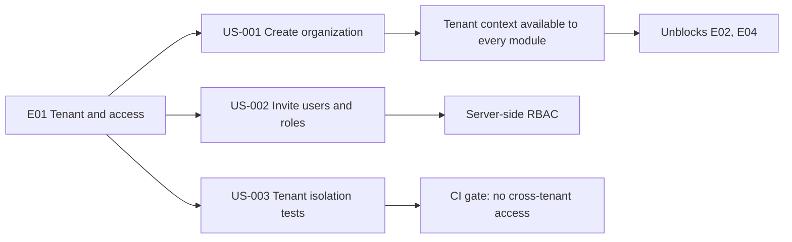
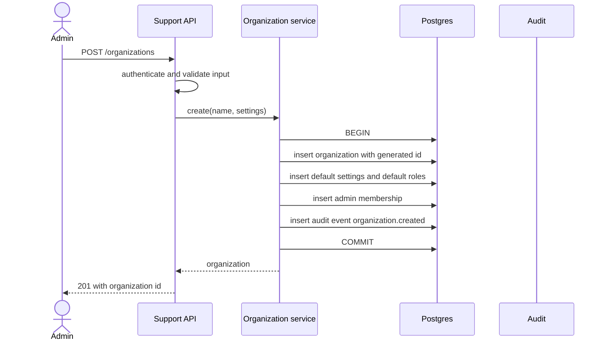
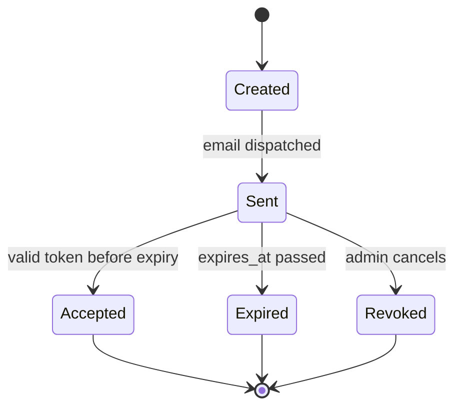
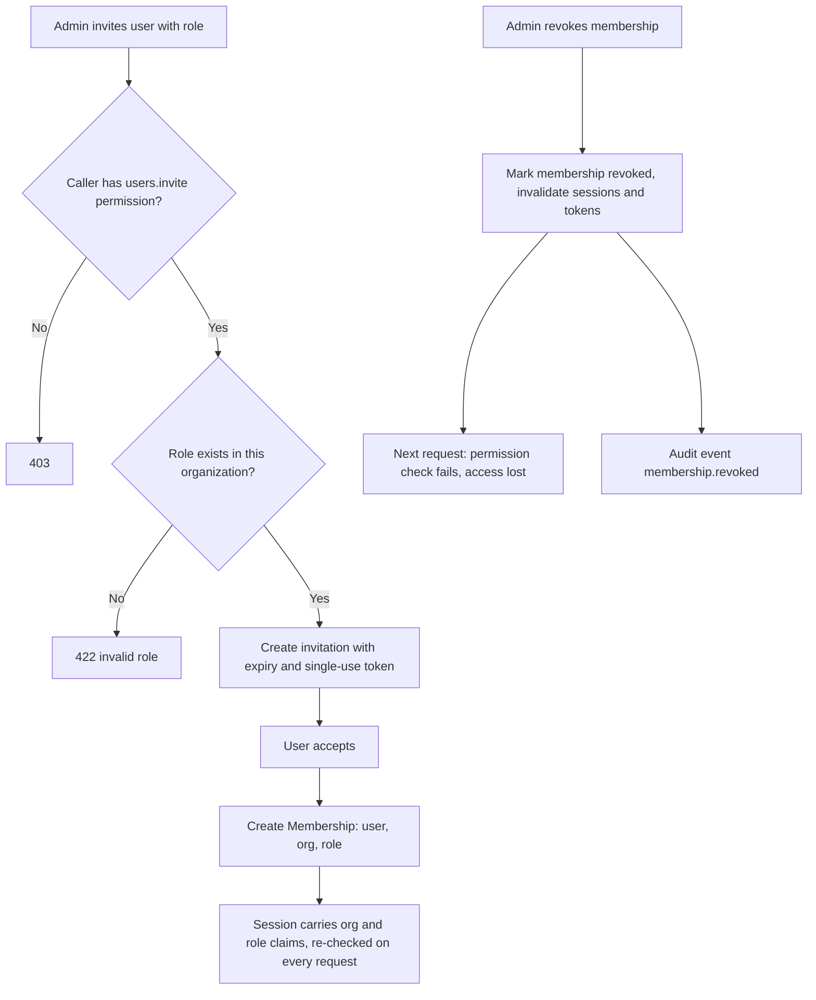
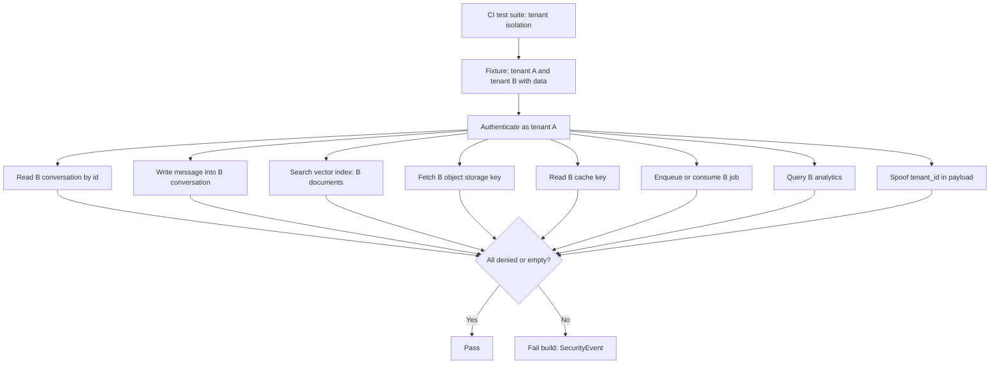
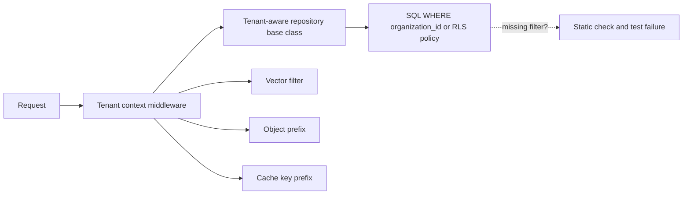

# E01 — Tenant and Access Foundation

Goal: establish secure organization boundaries. Modules: M18, M20.

## Epic overview

## US-001 — Create and configure an organization

Acceptance: ID generated, default settings exist, audit event recorded.

## US-002 — Invite users and assign roles

Acceptance: invitation expires, role validated server-side, revoked users lose access.

### Invitation lifecycle

### Role assignment and revocation

## US-003 — Test tenant isolation

Acceptance: cross-tenant read and write attempts are denied in automated tests.

### Where tenant filtering is enforced

