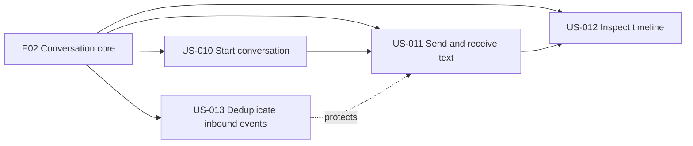
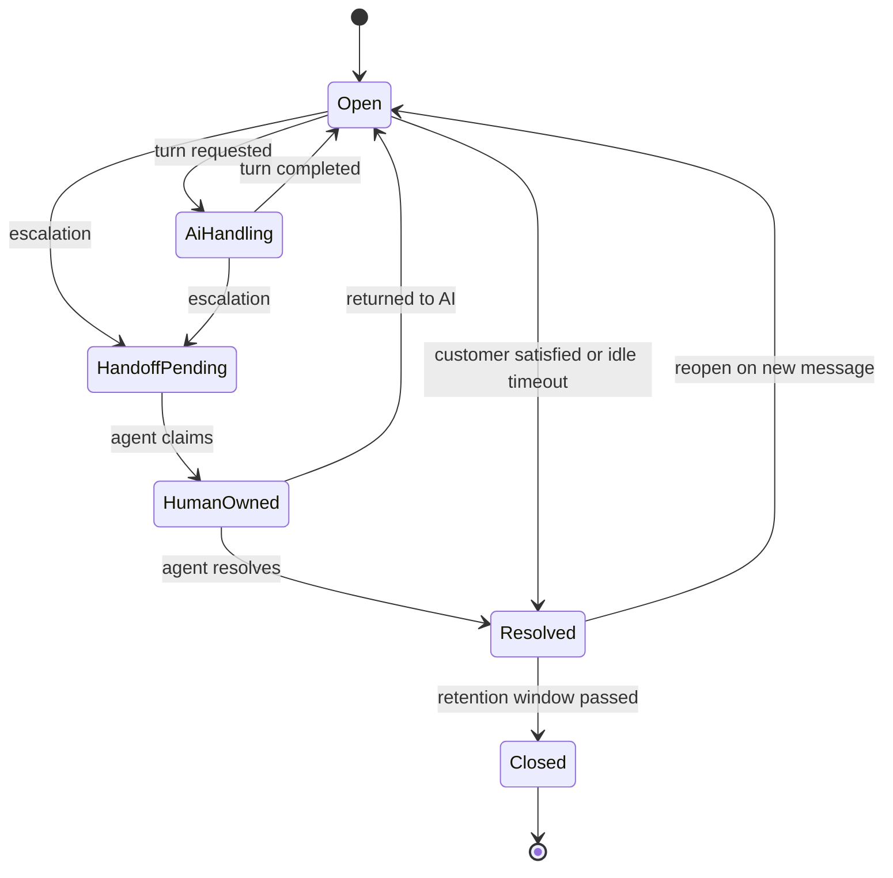
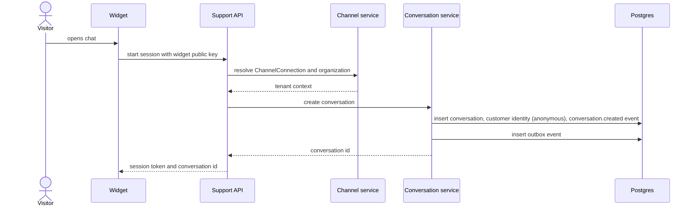
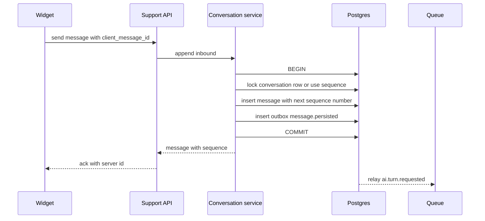
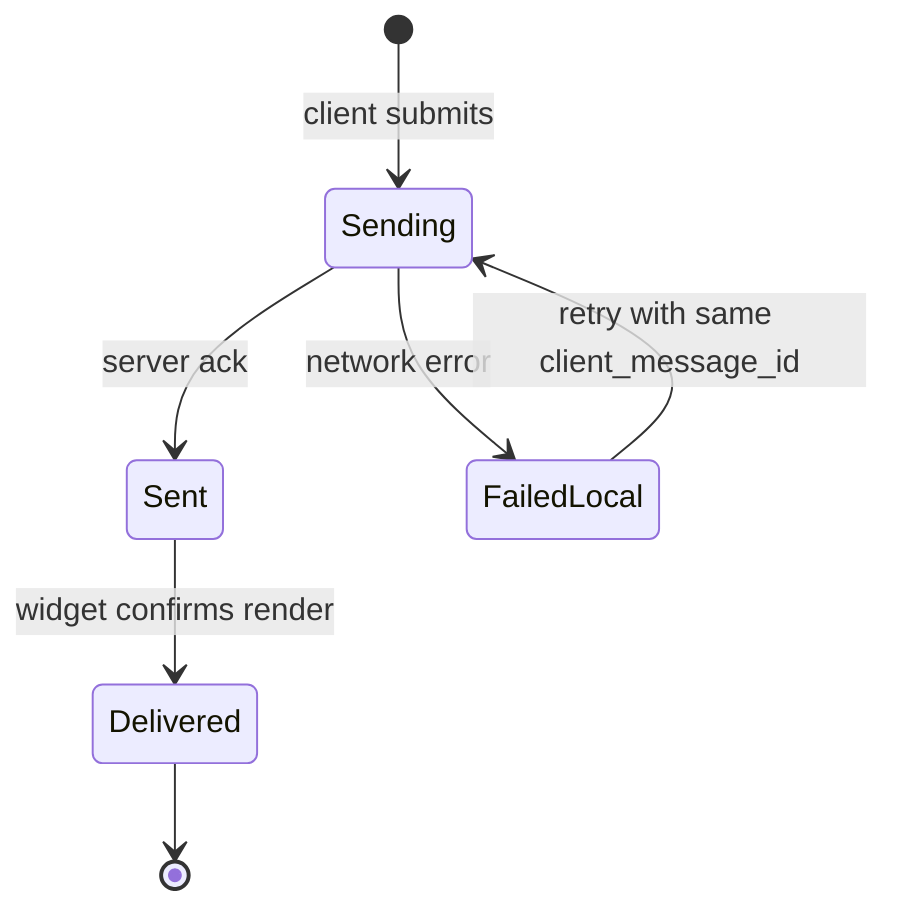
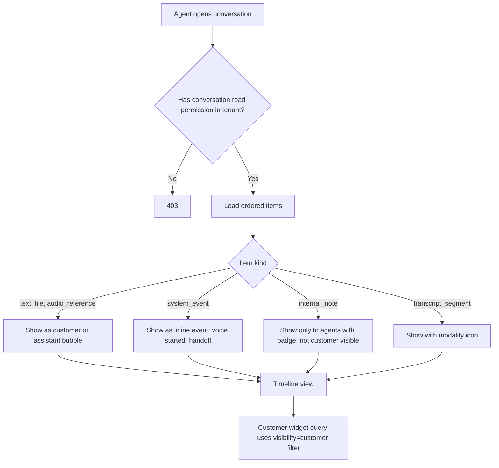
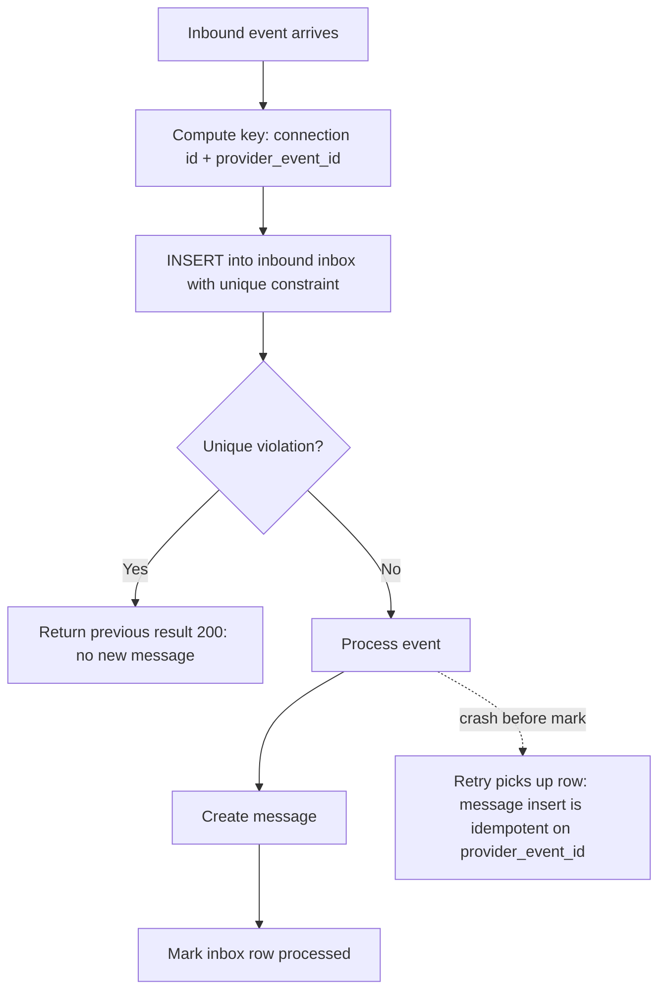

# E02 — Conversation and Message Core

Goal: persist and retrieve a reliable conversation timeline. Modules: M01, M02, M03.

## Epic overview

## Conversation lifecycle (used by all stories)

## US-010 — Start a conversation through website chat

Acceptance: tenant and channel scoped, initial event persisted.

## US-011 — Send and receive text messages

Acceptance: stable ordering, delivery status represented, errors recoverable.

### Ordering and persistence

### Message delivery status as seen by the customer

## US-012 — Support agent inspects the timeline

Acceptance: messages, system events and visibility levels are distinguished.

## US-013 — Deduplicate inbound events

Acceptance: a replayed provider event does not create a duplicate message.

