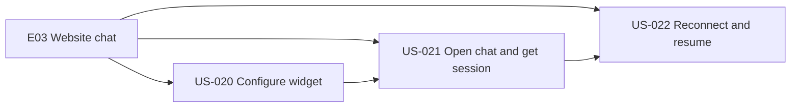
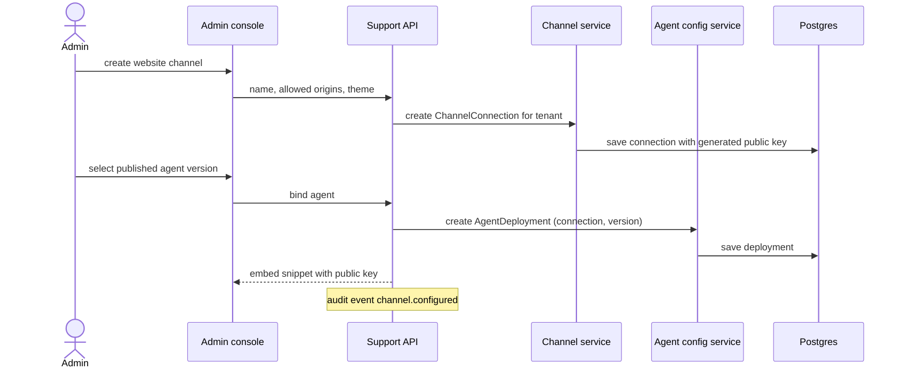
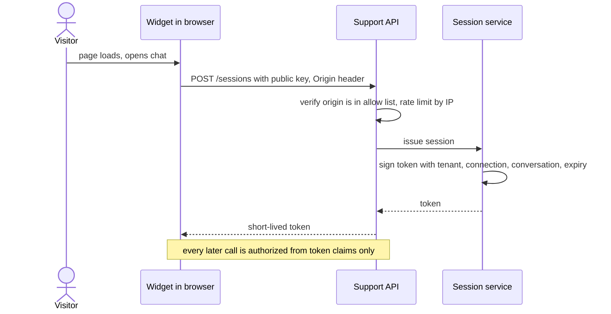
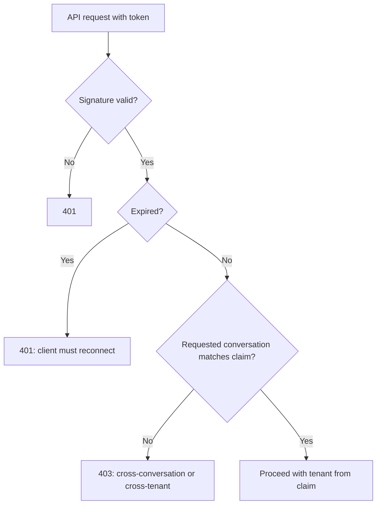
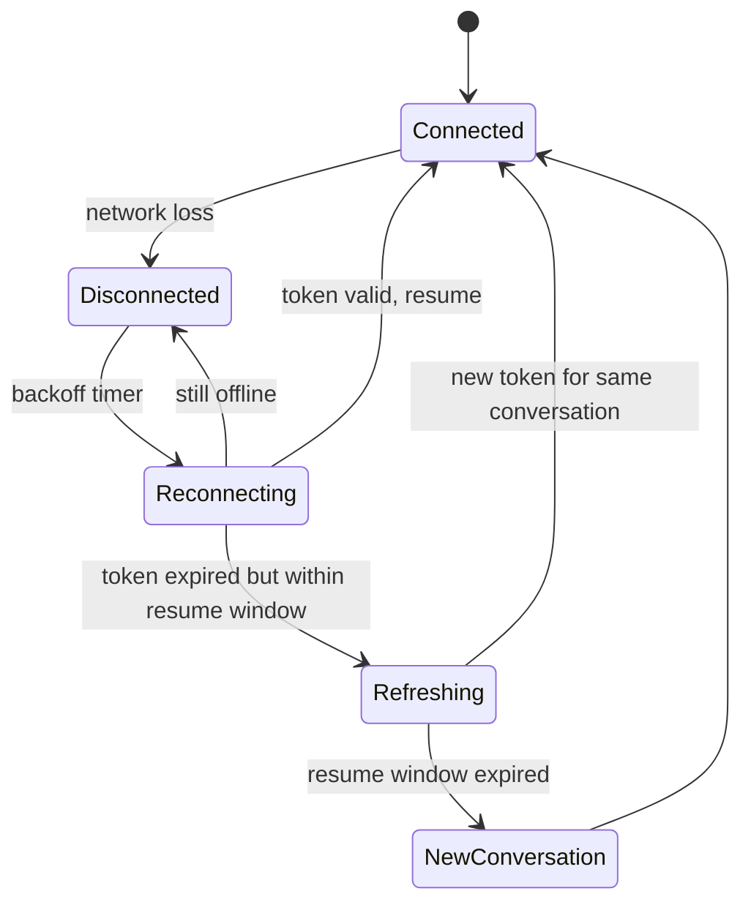
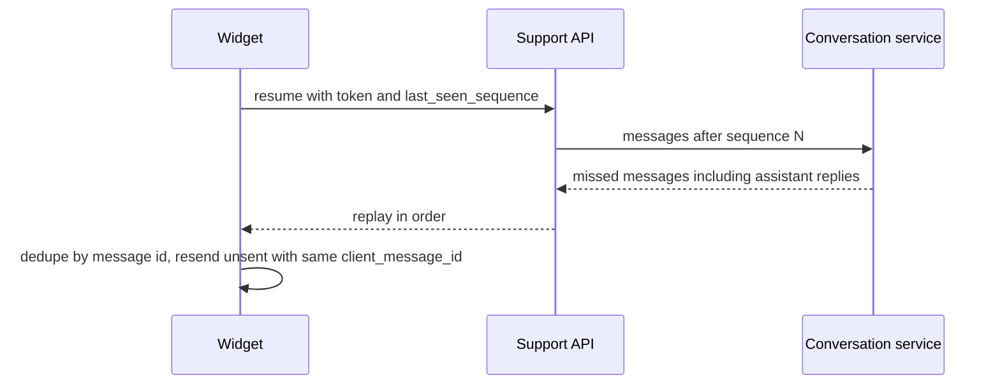

# E03 — Website Chat Channel

Goal: first customer-facing channel. Modules: M02, M03.

## Epic overview

## US-020 — Administrator configures the website widget

Acceptance: widget associated with correct organization and agent configuration.

## US-021 — Visitor opens chat and receives a session

Acceptance: session token is scoped, expires, cannot access other tenants.

### Token claim checks

## US-022 — Reconnect after temporary network failure

Acceptance: existing conversation can be resumed under valid session policy.

