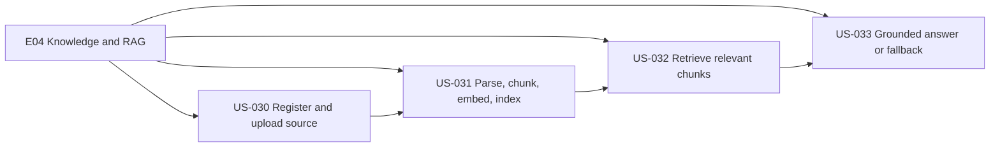
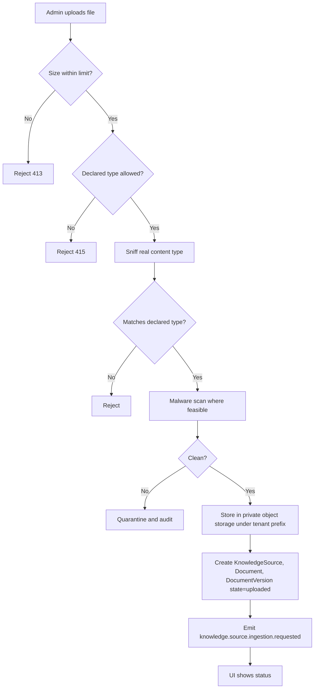
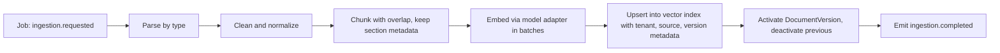
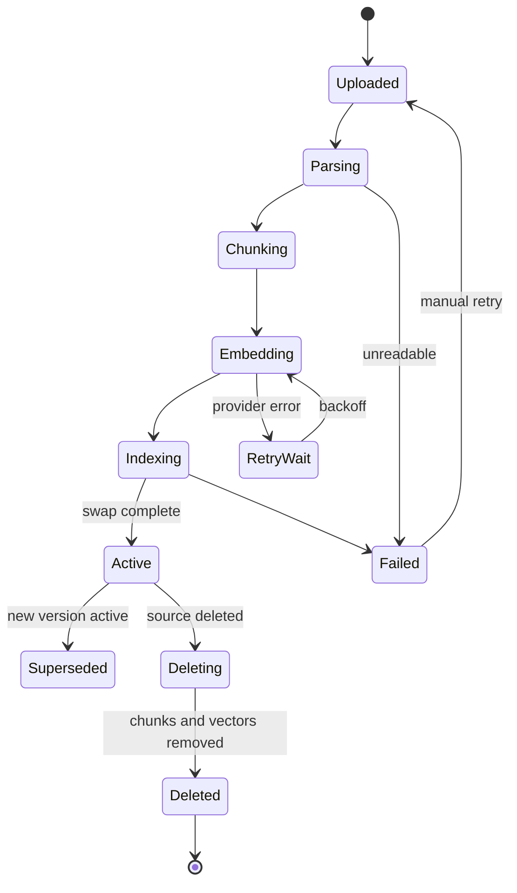
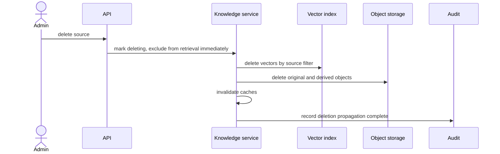
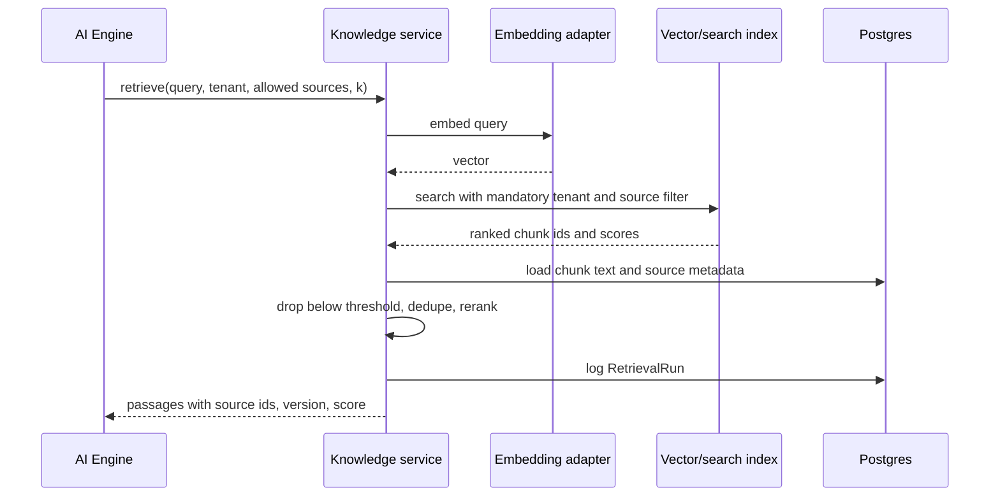
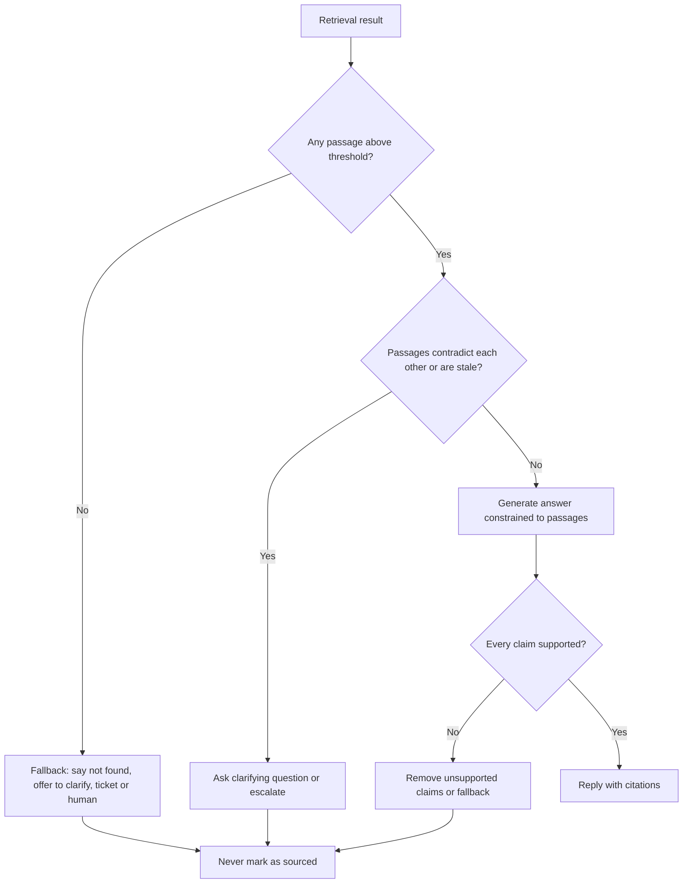

# E04 — Knowledge Ingestion and RAG

Goal: ground answers in organization-approved sources. Module: M05.

## Epic overview

## US-030 — Register and upload a knowledge source

Acceptance: file limits and type checks enforced; ingestion state visible.

## US-031 — Parse, chunk, embed and index asynchronously

Acceptance: failed ingestion can be retried; document version traceable.

### Pipeline

### Ingestion state machine

### Deletion and freshness propagation

## US-032 — Retrieve relevant chunks

Acceptance: tenant-filtered results with source metadata.

## US-033 — Grounded answer or clear fallback

Acceptance: answer is not represented as sourced when retrieval has no useful evidence.

