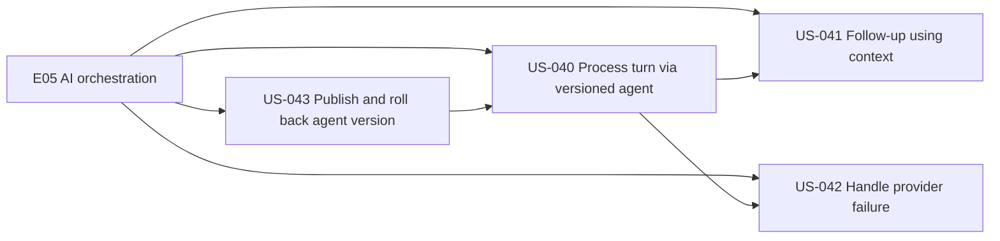
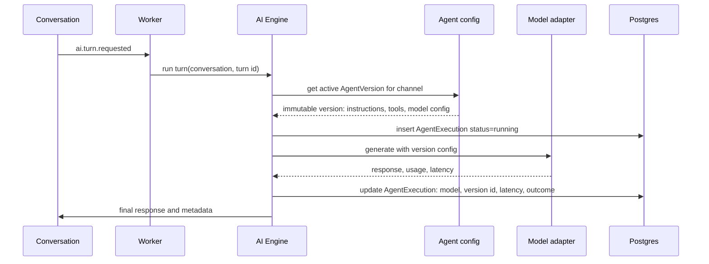
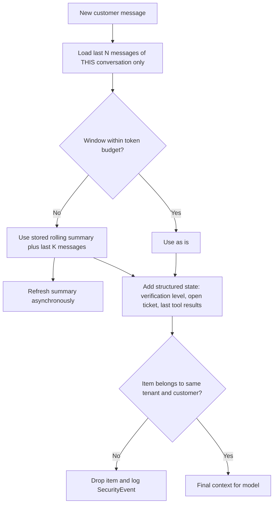
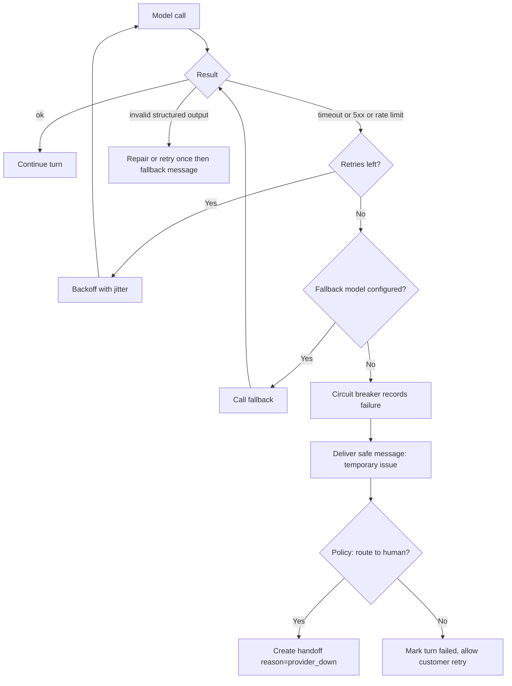
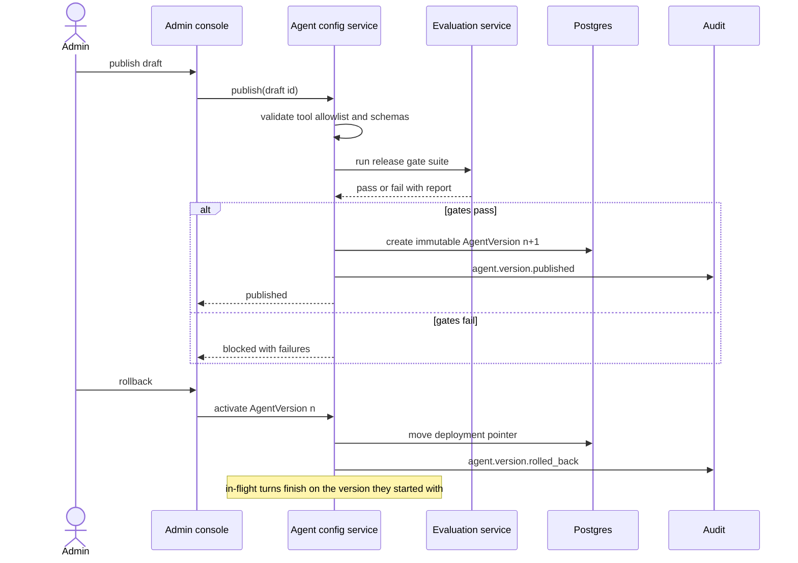

# E05 — AI Orchestration

Goal: coordinate each conversation turn safely. Modules: M04, M19. Detailed turn pipeline: see `../03-ai-engine.md`.

## Epic overview

## US-040 — Process a turn through a versioned agent configuration

Acceptance: model/config version, latency and outcome recorded.

## US-041 — Follow-up question using conversation context

Acceptance: relevant recent context used without exposing another customer's data.

## US-042 — Handle model timeout or provider failure

Acceptance: bounded retry/fallback; no false success message delivered.

## US-043 — Publish and roll back an agent version

Acceptance: published versions immutable and audit logged.

