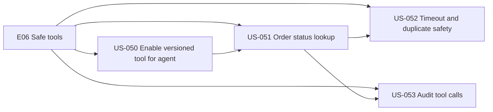
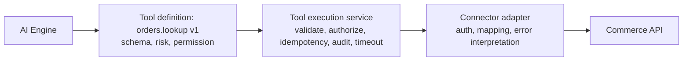
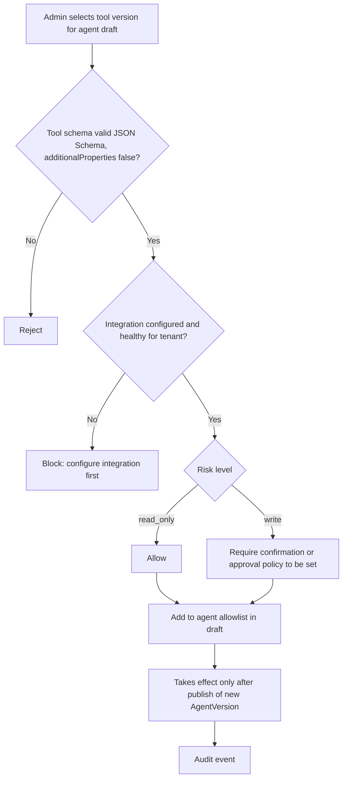
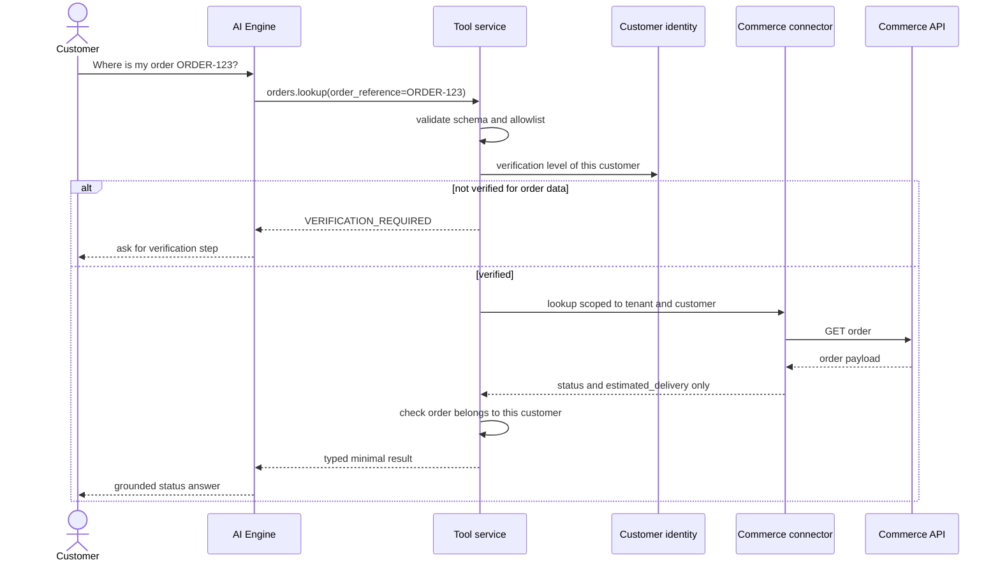
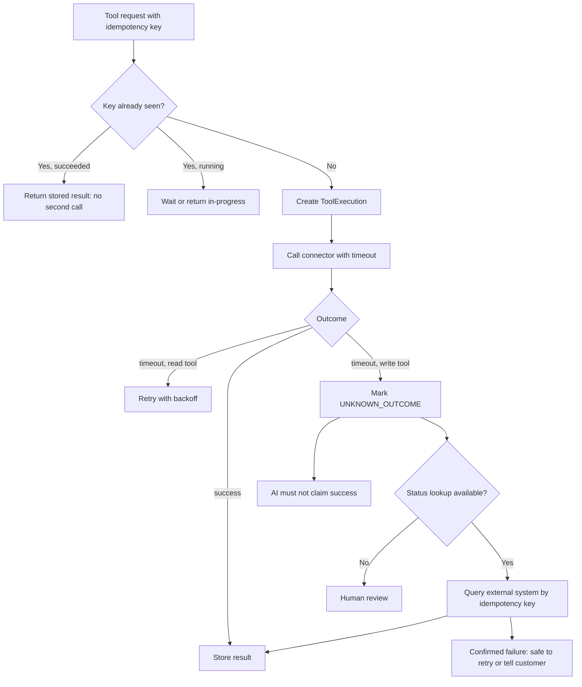
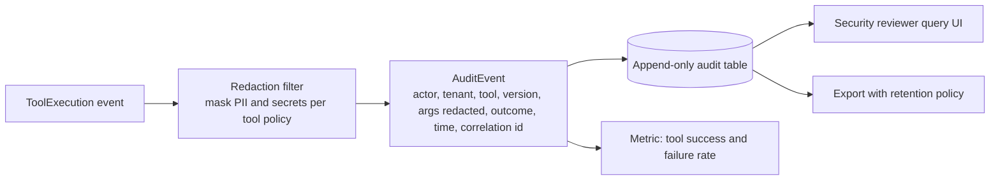

# E06 — Safe Business Tools

Goal: let the AI invoke a small allowlisted set of operations. Modules: M06, M15. Full pipeline: see `../02-cross-cutting-flows.md` sections 2.5 and 2.6.

## Epic overview

## Three-layer connector architecture

## US-050 — Enable a versioned tool for an agent

Acceptance: tool must be allowlisted and schema-valid.

## US-051 — Customer asks for order status

Acceptance: verification and tenant scope checked; typed minimal result.

## US-052 — Handle tool timeout and duplicate requests

Acceptance: idempotency behavior defined; unknown write outcome not blindly retried.

## US-053 — Audit tool calls

Acceptance: actor, tool/version, outcome, timestamp, correlation id with redaction.

