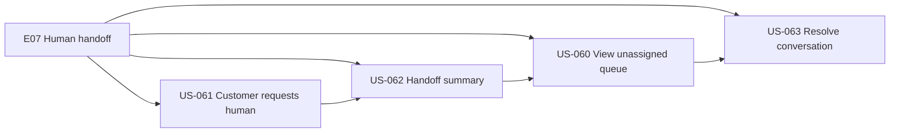
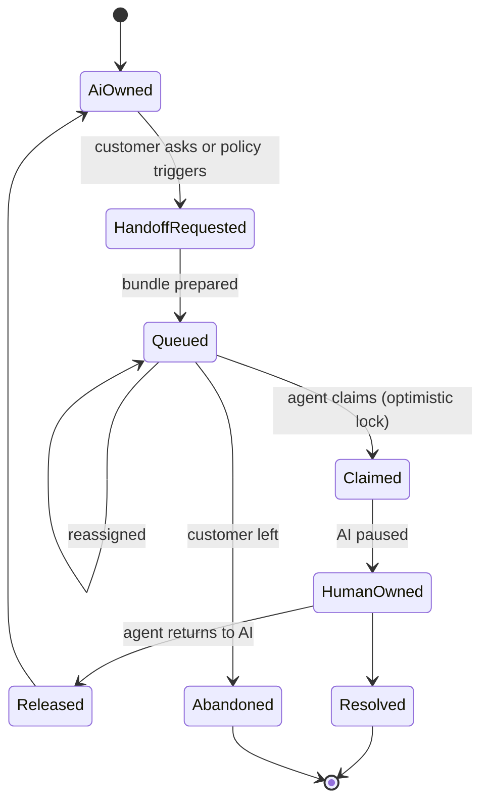
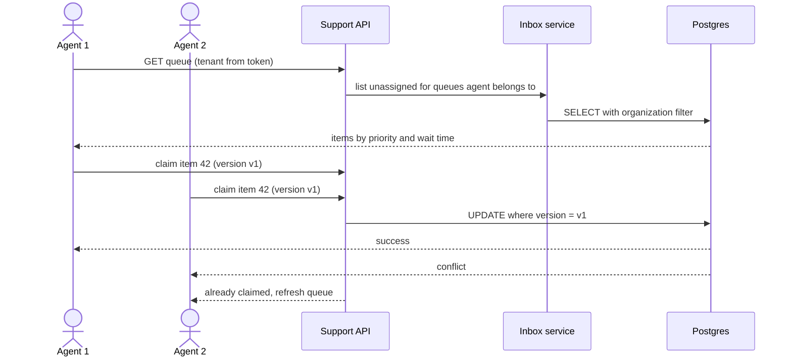
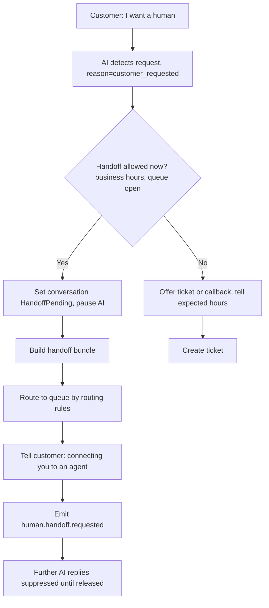
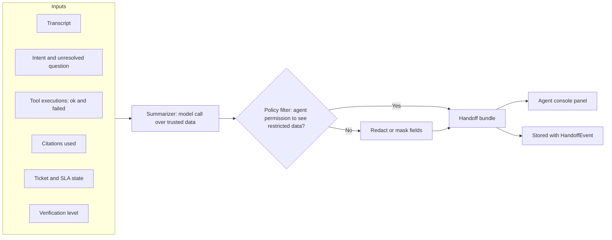
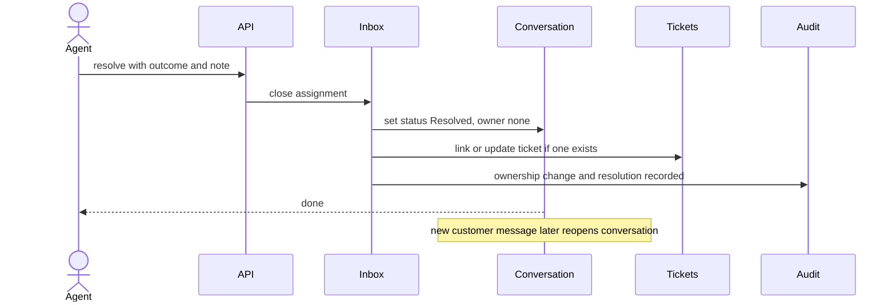

# E07 — Human Inbox and Handoff

Goal: a human can take over with context. Modules: M10, M13.

## Epic overview

## Ownership model

## US-060 — Support agent views the unassigned queue

Acceptance: tenant scoped, supports assignment.

## US-061 — Customer requests a human

Acceptance: AI stops responding when handoff policy requires; clear status for customer.

## US-062 — Handoff summary for the agent

Acceptance: transcript, unresolved request, prior tool outcomes permitted by policy.

## US-063 — Support agent resolves the conversation

Acceptance: resolution and ownership changes recorded.

