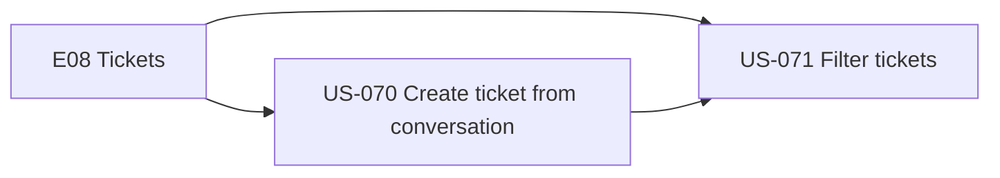
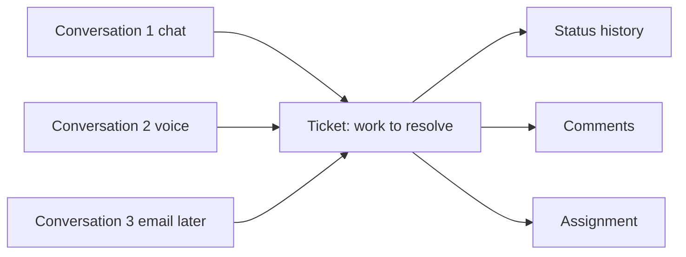
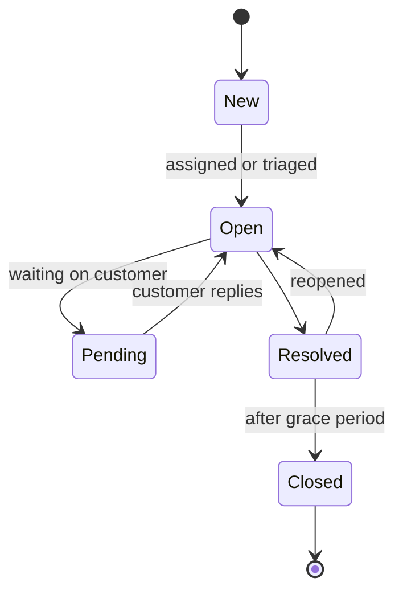
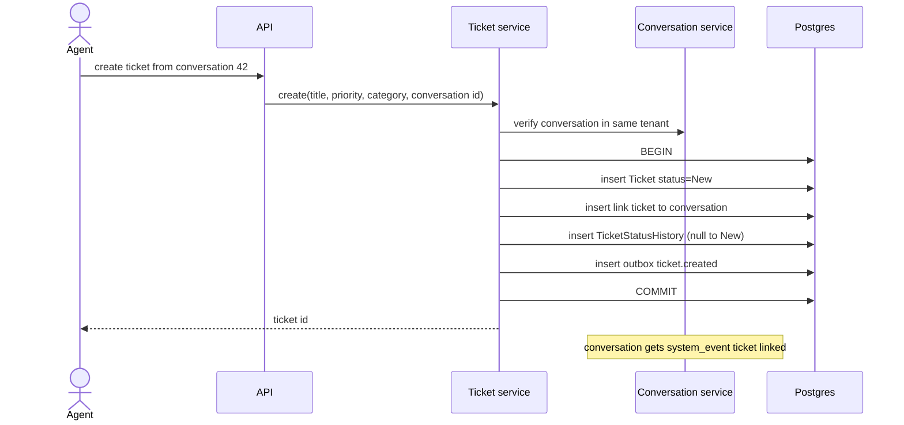
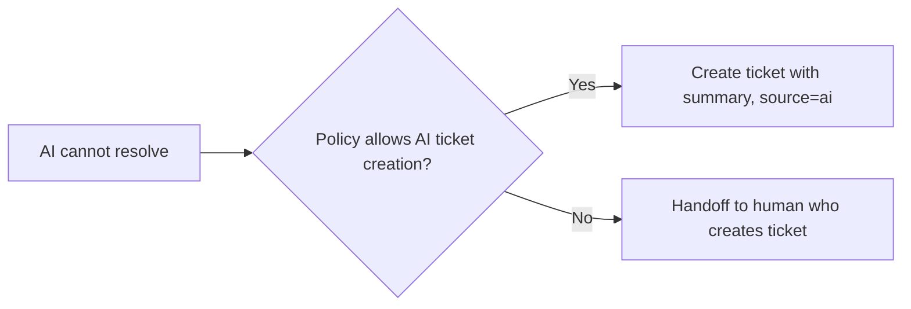
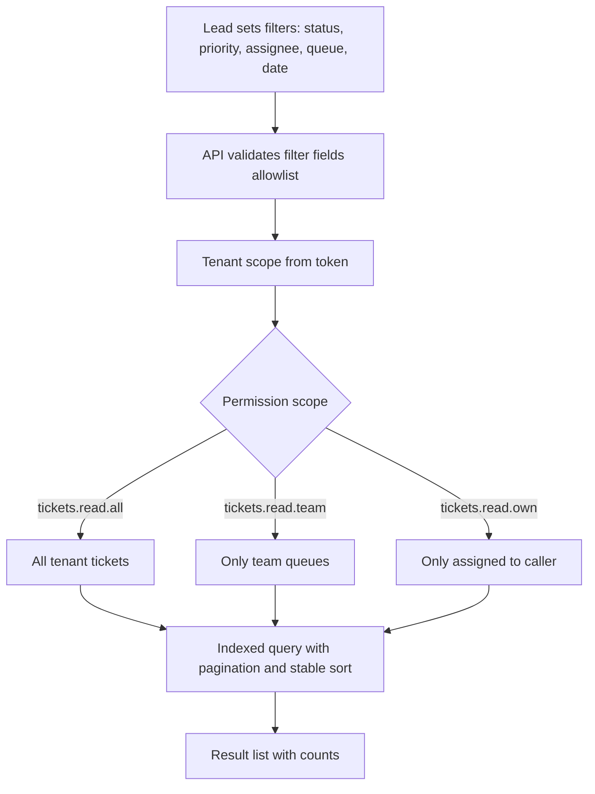

# E08 — Tickets and Case Tracking

Goal: track support work beyond one interaction. Module: M11.

## Epic overview

## Conversation vs ticket

## Ticket status lifecycle

## US-070 — Create a ticket from a conversation

Acceptance: ticket links to source conversation and has a status history.

AI-initiated variant:

## US-071 — Support lead filters tickets

Acceptance: filters respect permissions and tenant boundaries.

