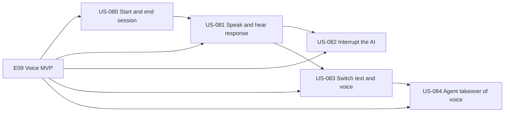
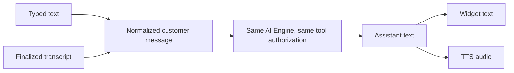
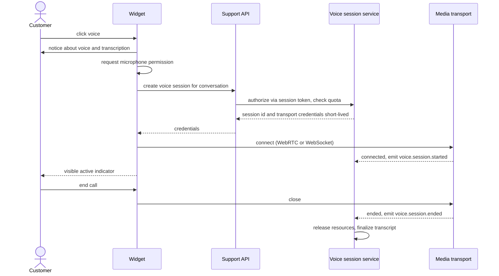
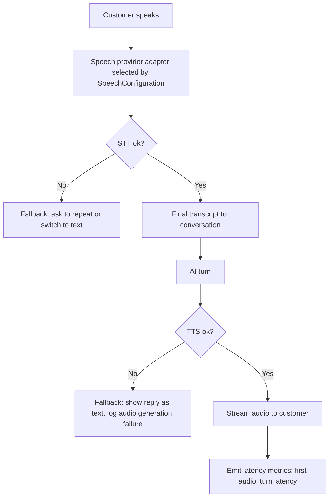
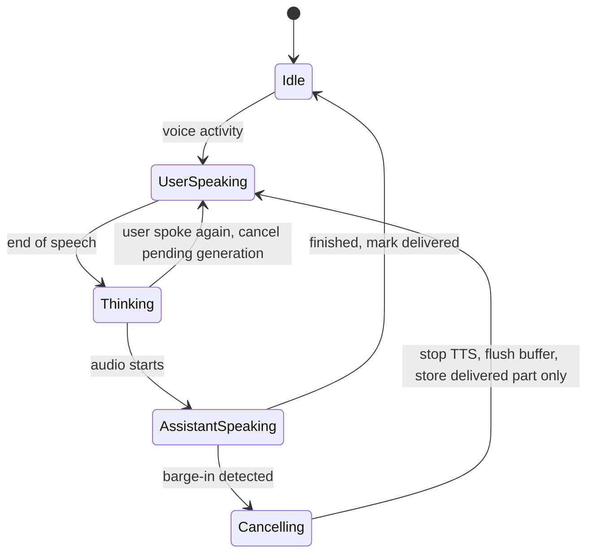
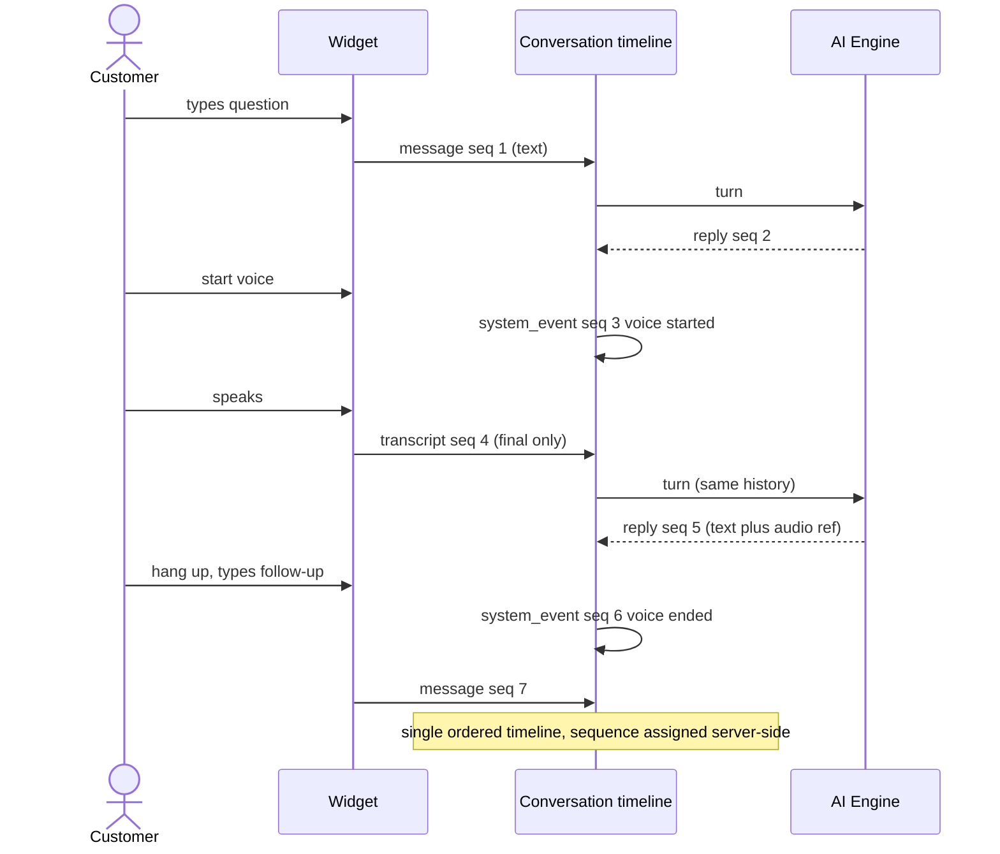
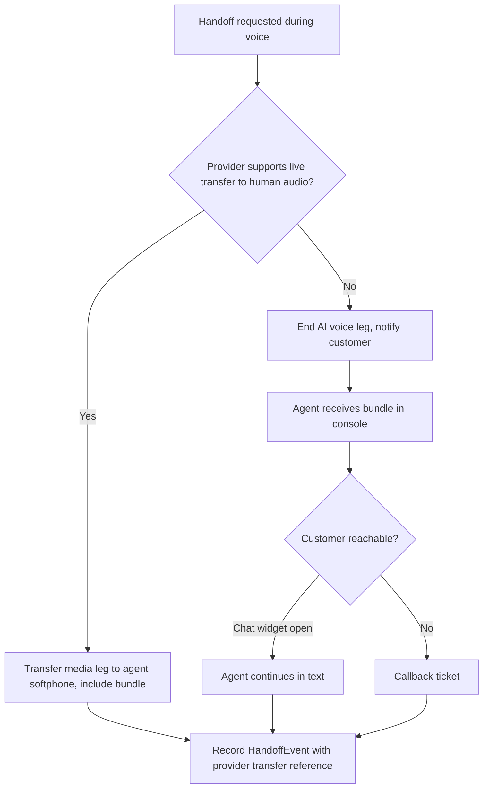

# E09 — Voice MVP

Goal: real-time browser voice using the same conversation engine. Modules: M07, M08, M09. Deeper voice diagrams: see `../04-voice-multimodal.md`.

## Epic overview

## Reuse of the text engine

## US-080 — Start and end a voice session

Acceptance: explicit mic permission; session state and failures visible.

## US-081 — Speak and receive a spoken response

Acceptance: provider configurable; failures have fallback path.

## US-082 — Interrupt the AI while it speaks

Acceptance: obsolete audio cancelled or truncated; not recorded as fully delivered.

## US-083 — Switch between text and voice

Acceptance: finalized transcript and message order remain coherent.

## US-084 — Agent takes over a voice conversation or receives its context

Acceptance: handoff behavior explicit for chosen telephony/media provider.

