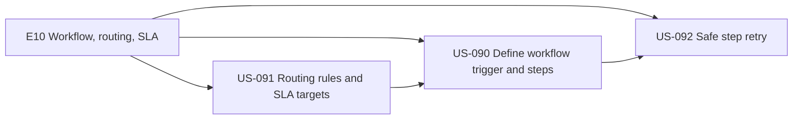
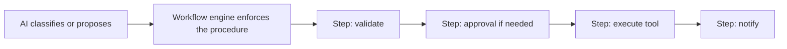
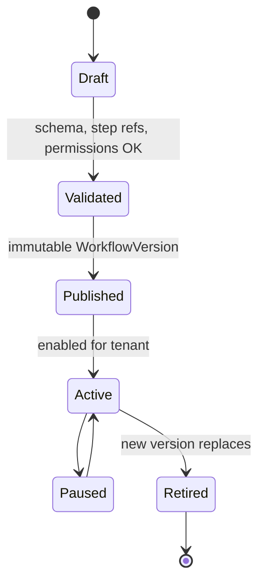
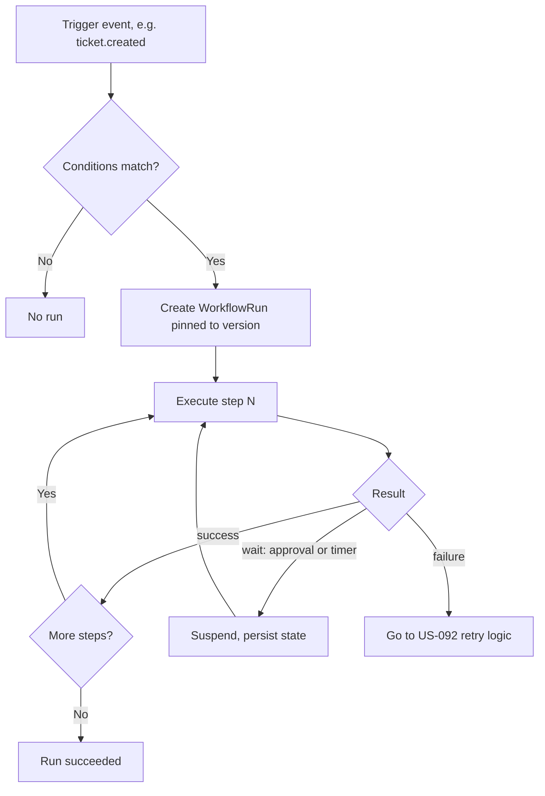
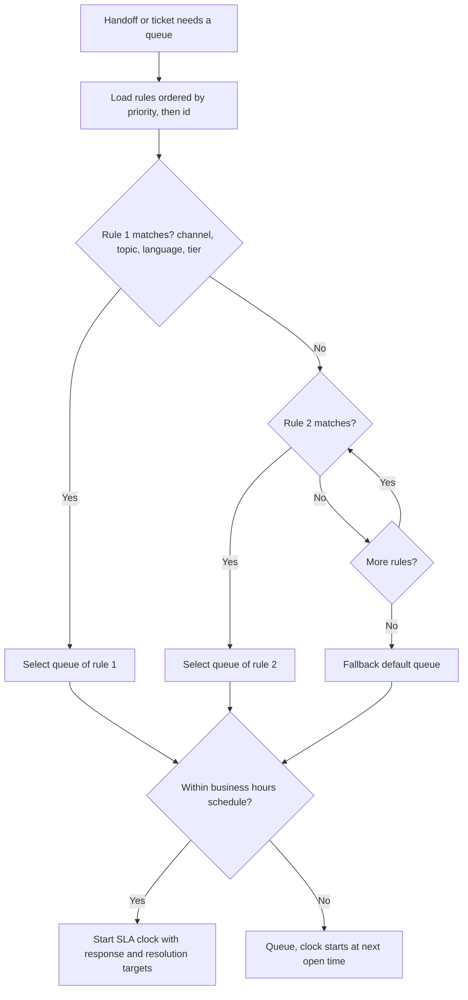
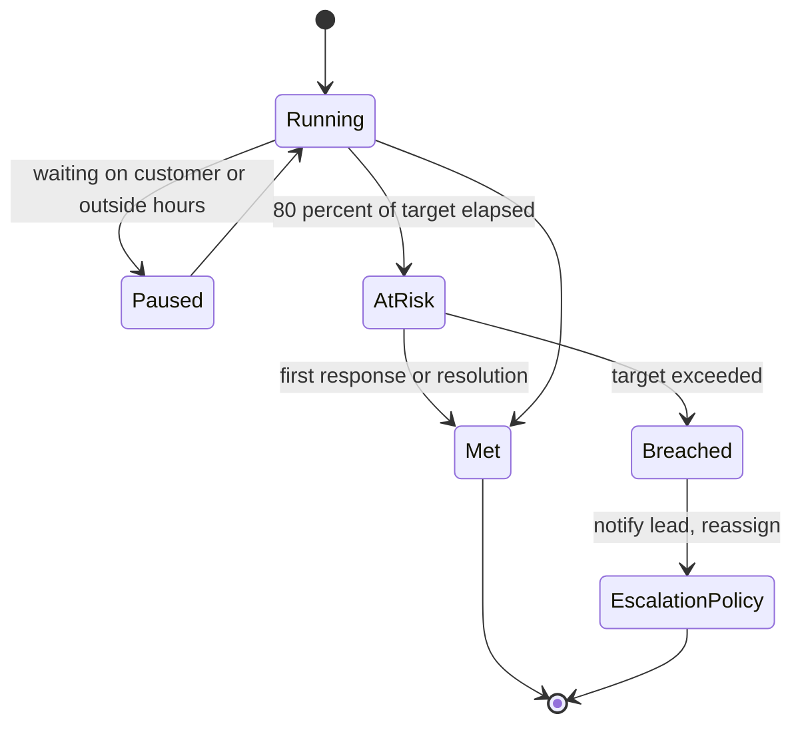
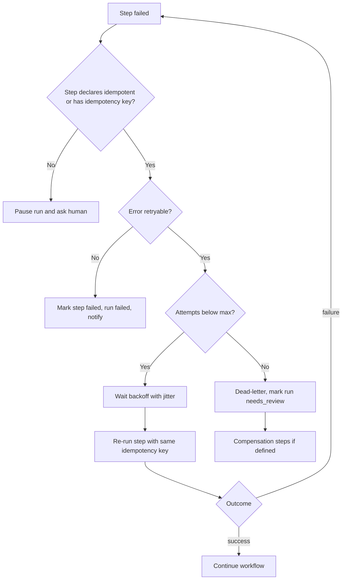

# E10 — Workflow, Routing and SLA

Goal: automate repeatable support operations. Modules: M12, M13, M14.

## Epic overview

## Principle: deterministic procedure, AI proposes

## US-090 — Define workflow trigger and steps

Acceptance: workflow version, run state and failures visible.

### Authoring and versioning

### Run execution

## US-091 — Routing rules and SLA targets

Acceptance: rule priority and fallback behavior are deterministic.

### SLA timers

## US-092 — Retry a failed workflow step safely

Acceptance: retry policy bounded; idempotency defined per step.

