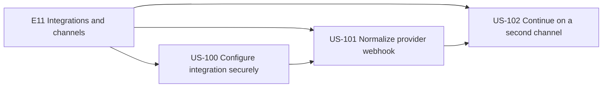
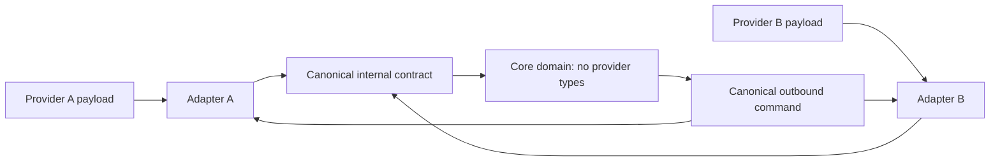
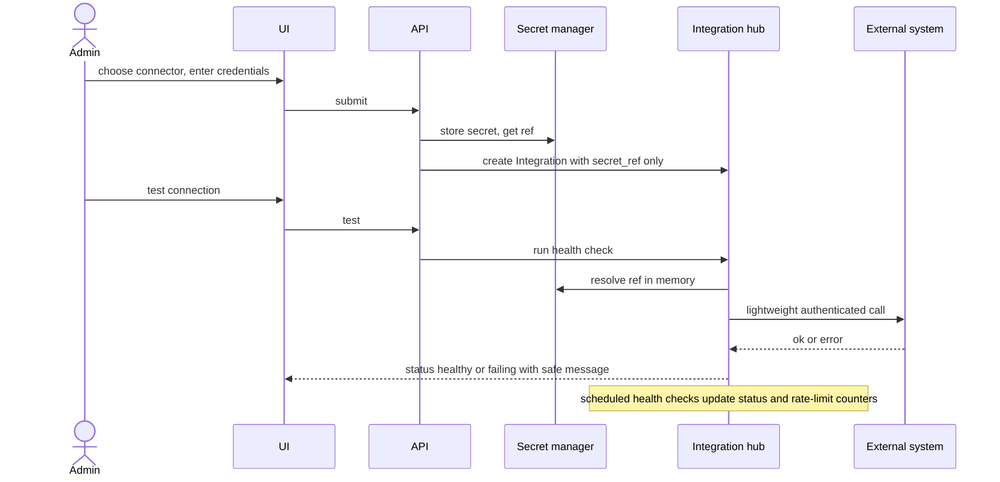
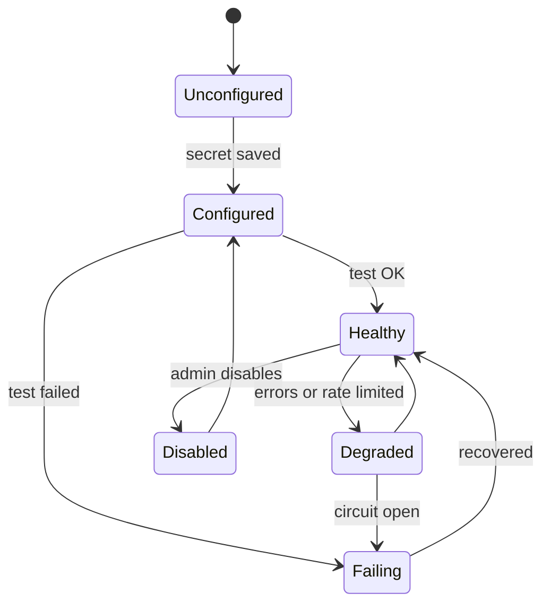
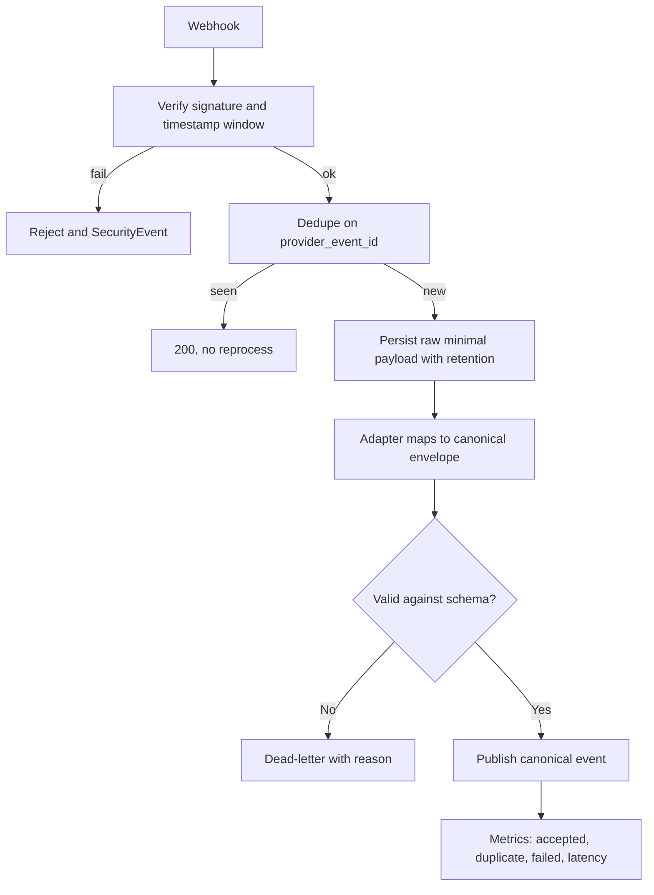
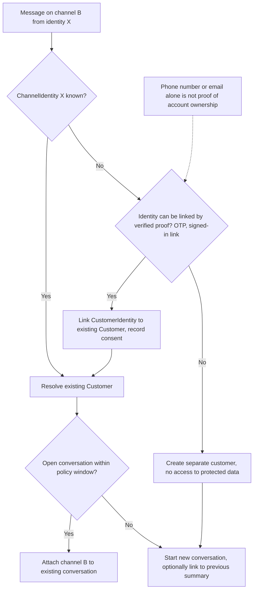

# E11 — Integrations and Additional Channels

Goal: add provider connectors without contaminating core domain logic. Modules: M02, M15.

## Epic overview

## Adapter boundary

## US-100 — Configure an integration securely

Acceptance: credentials are secret references; test status and health visible.

### Integration health states

## US-101 — Normalize provider webhook into canonical event

Acceptance: signature verified; replay deduplicated; processing observable.

## US-102 — Continue support through a second channel

Acceptance: identity linking follows verification policy; duplicate conversations avoided where possible.

