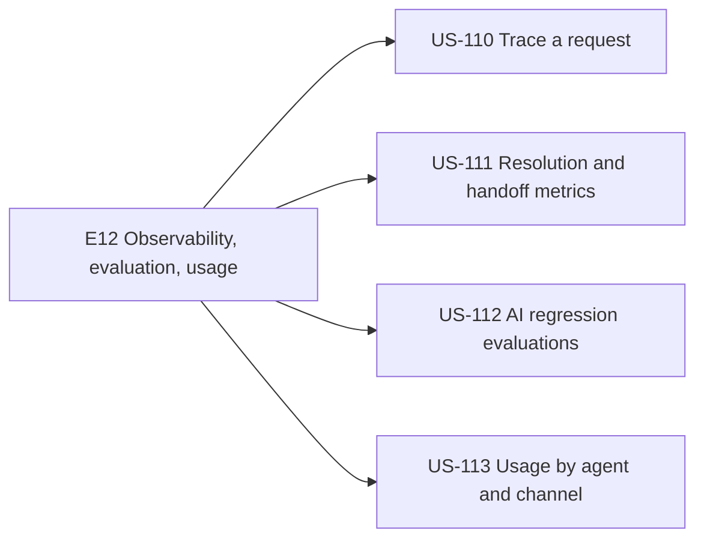
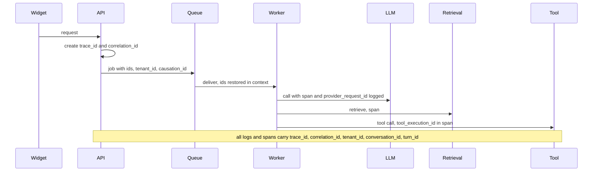
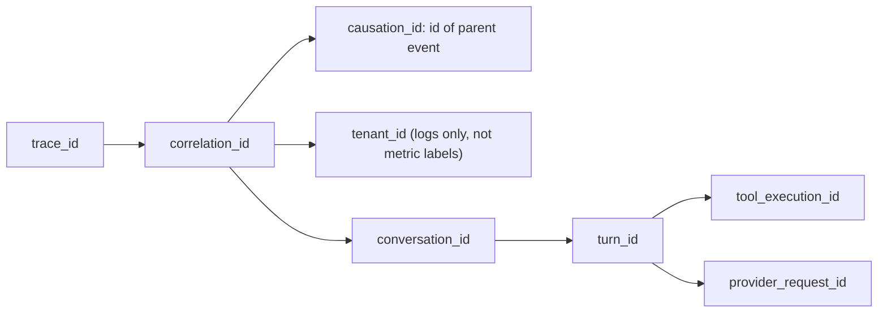
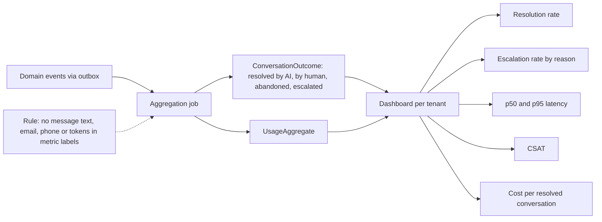
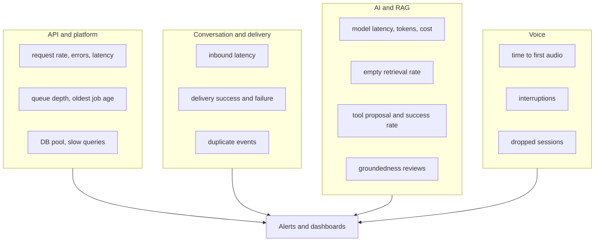
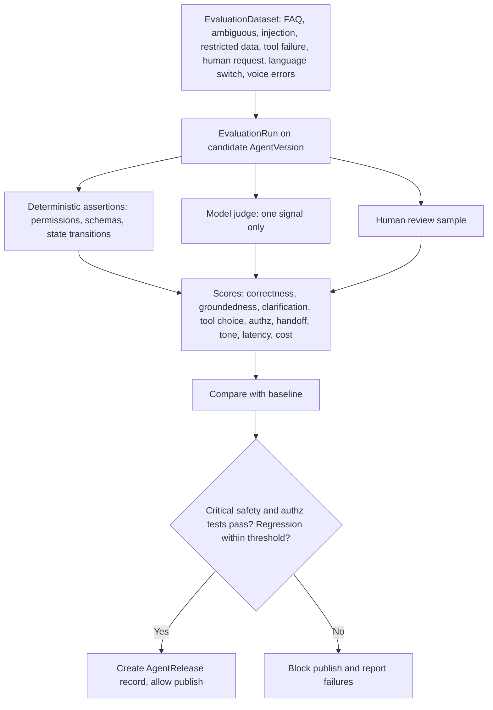
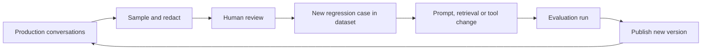
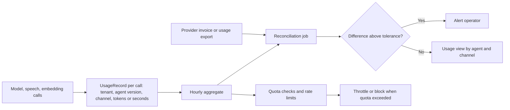

# E12 — Observability, Evaluation and Usage

Goal: operate and improve the platform with evidence. Modules: M16, M17, M20. Source: `10-observability-and-evaluation.md`.

## Epic overview

## US-110 — Trace one request across modules

Acceptance: correlation ids connect API, worker, model, retrieval and tool activity.

### Correlation identifiers

## US-111 — Resolution and handoff metrics

Acceptance: definitions documented; metrics tenant-safe.

### Platform signal groups

## US-112 — Run AI regression evaluations

Acceptance: dataset and agent/model version recorded; critical policy tests gate release.

### Improvement loop

## US-113 — Inspect usage by agent and channel

Acceptance: provider usage reconciled; sensitive data not exposed in metrics.

