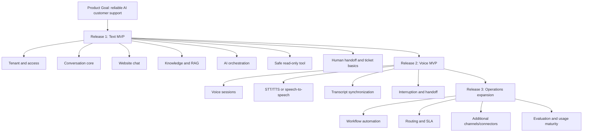
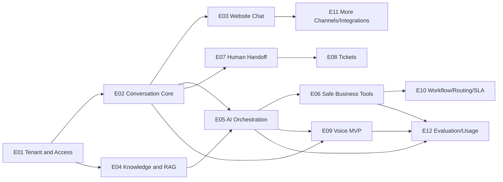
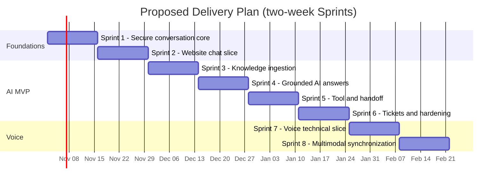
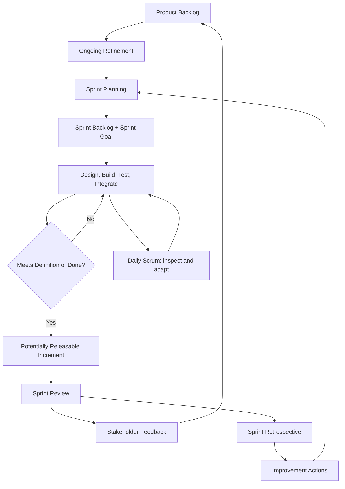
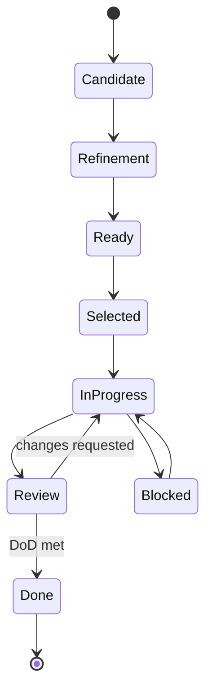
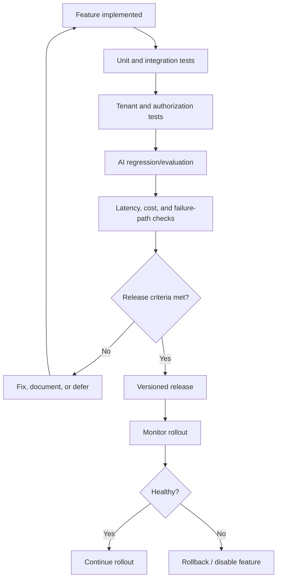
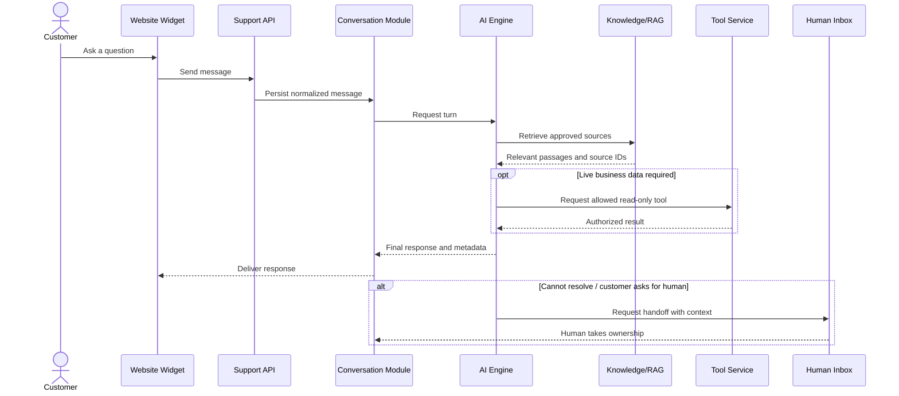
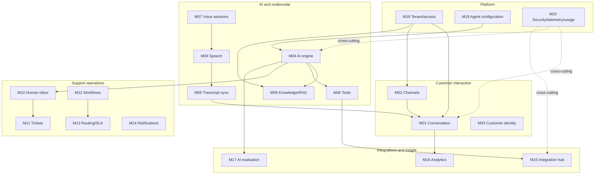

# Scrum Mermaid Artifacts (copied from scrum/05-mermaid-artifacts.md)

Paste these blocks into a Mermaid-compatible Markdown renderer. Keep them in source control and update them when the backlog or delivery plan changes.

## 1. Product roadmap

## 2. Epic dependency graph

## 3. Provisional Sprint timeline

**Important:** the dates above are illustrative placeholders to demonstrate the Gantt syntax, not a proposed current calendar. Replace the start date with the team's actual Sprint start date.

## 4. Scrum workflow

## 5. User story lifecycle

## 6. Release acceptance flow

## 7. Sprint Review demo path for the Text MVP

## 8. Module-to-epic coverage

