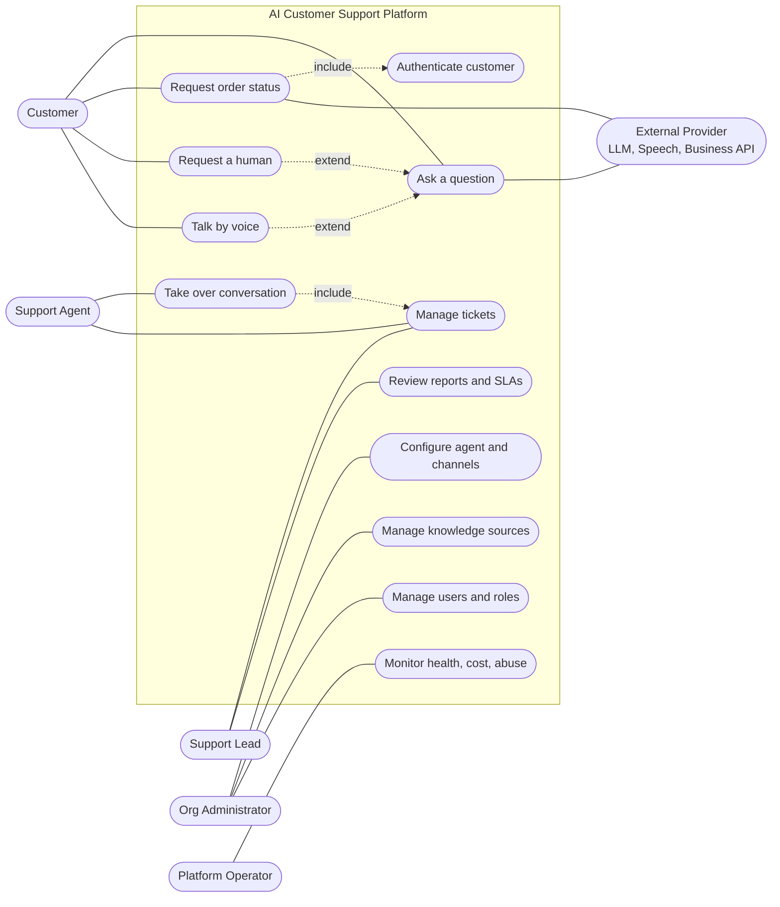
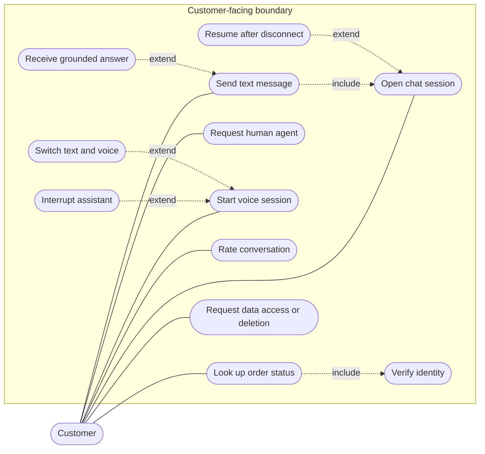
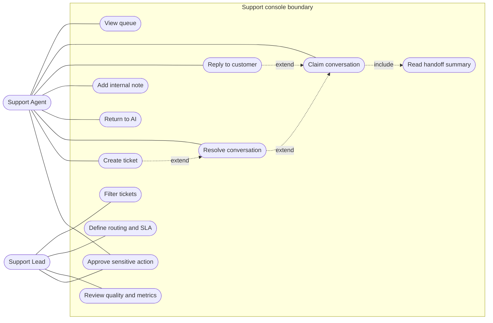
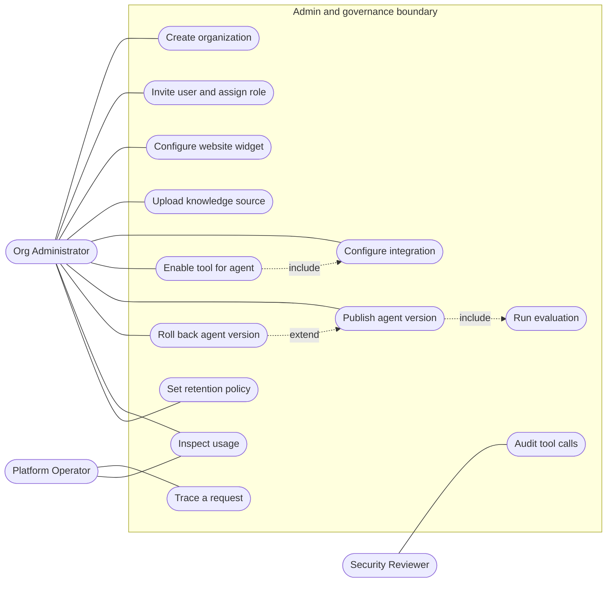

# U1 — UML Use Case Diagrams

Mermaid has no native use-case notation, so actors are drawn as stadium nodes outside a system-boundary subgraph and use cases as ellipses. `include` and `extend` relations are dotted arrows with stereotypes. Actors come from `01-product-vision.md`; use cases from the epics.

## U1.1 System-level use cases

## U1.2 Customer use cases

## U1.3 Support staff use cases

## U1.4 Administration and governance use cases

