# U2 — UML Class Diagrams

Design-level classes for the modular monolith. Names follow the module catalog (`02-module-catalog.md`) and domain model (`05-domain-model.md`). Attributes and operations are proposals for implementation, not final signatures. One diagram per module group keeps each readable.

## U2.1 Access and tenancy (M18)

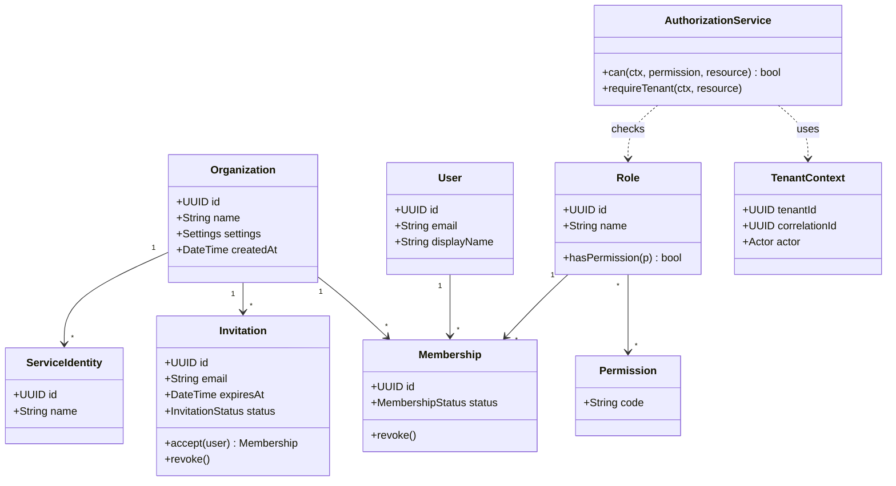

## U2.2 Conversation core (M01, M03)

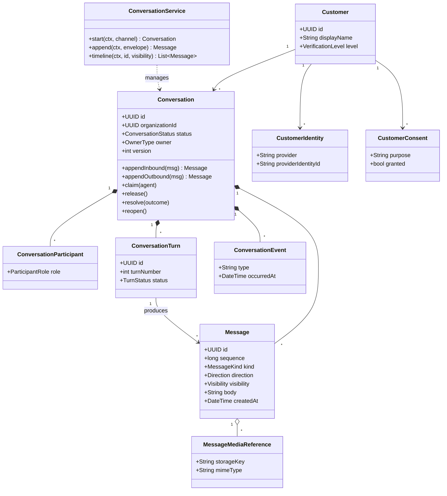

## U2.3 Channel management and delivery (M02)

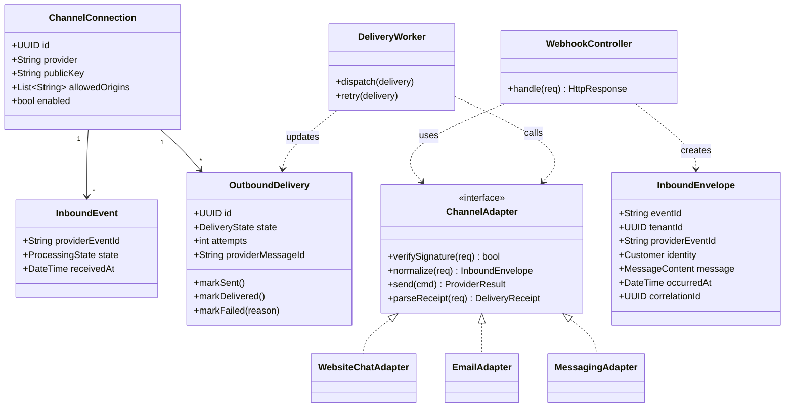

## U2.4 AI Conversation Engine: turn orchestration (M04)

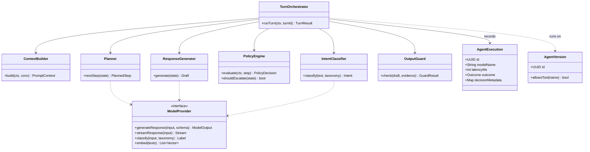

## U2.4b Agent configuration and versions (M19)

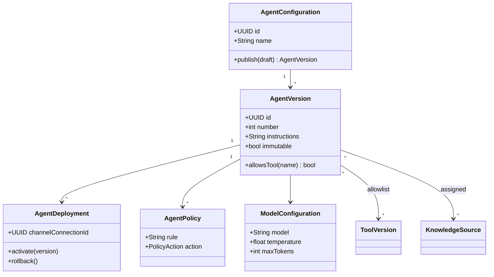

## U2.5 Knowledge and retrieval (M05)

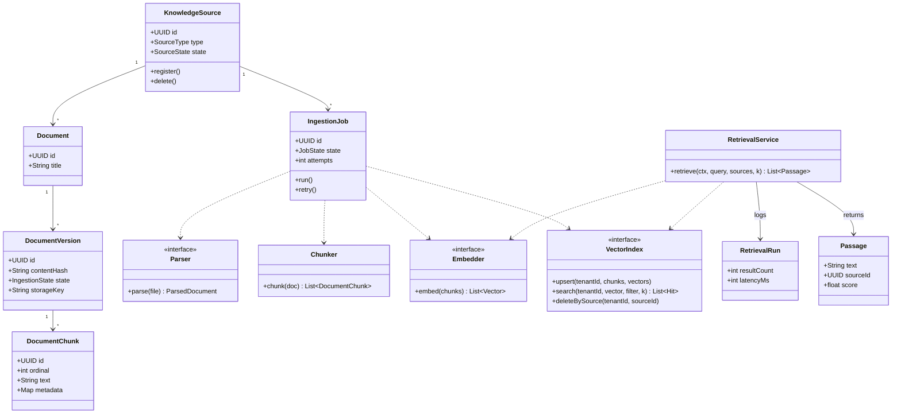

## U2.6 Tools: registry and execution (M06)

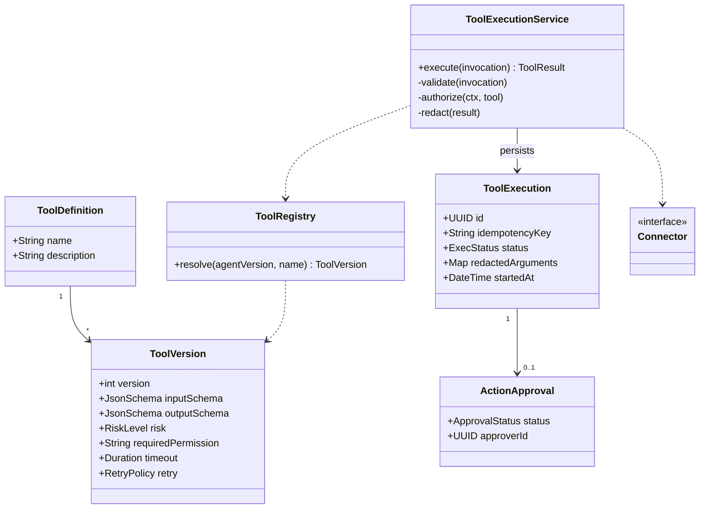

## U2.6b Integrations and connectors (M15)

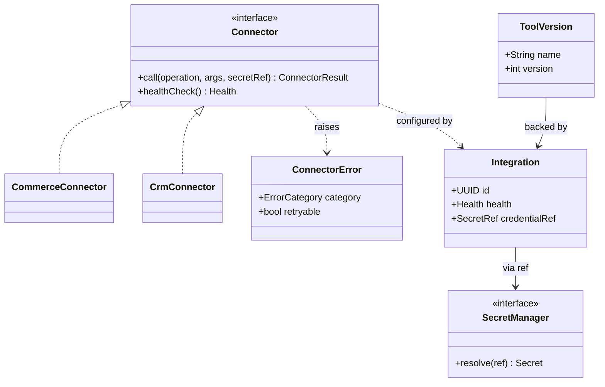

## U2.7 Human handoff and tickets (M10, M11, M13)

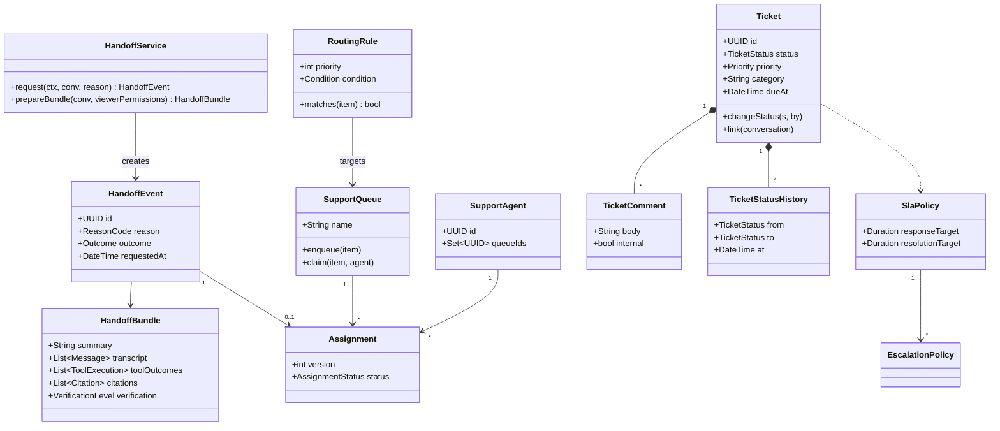

## U2.8 Voice and speech (M07, M08, M09)

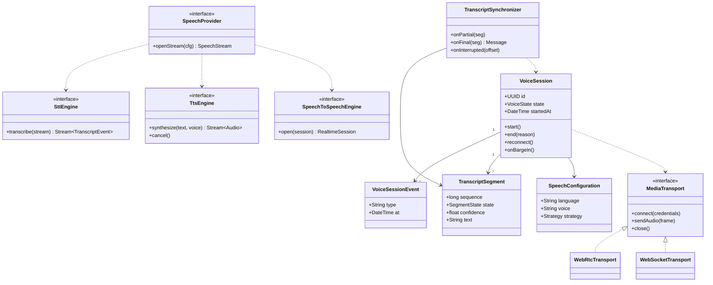

## U2.9 Workflow automation (M12) and notifications (M14)

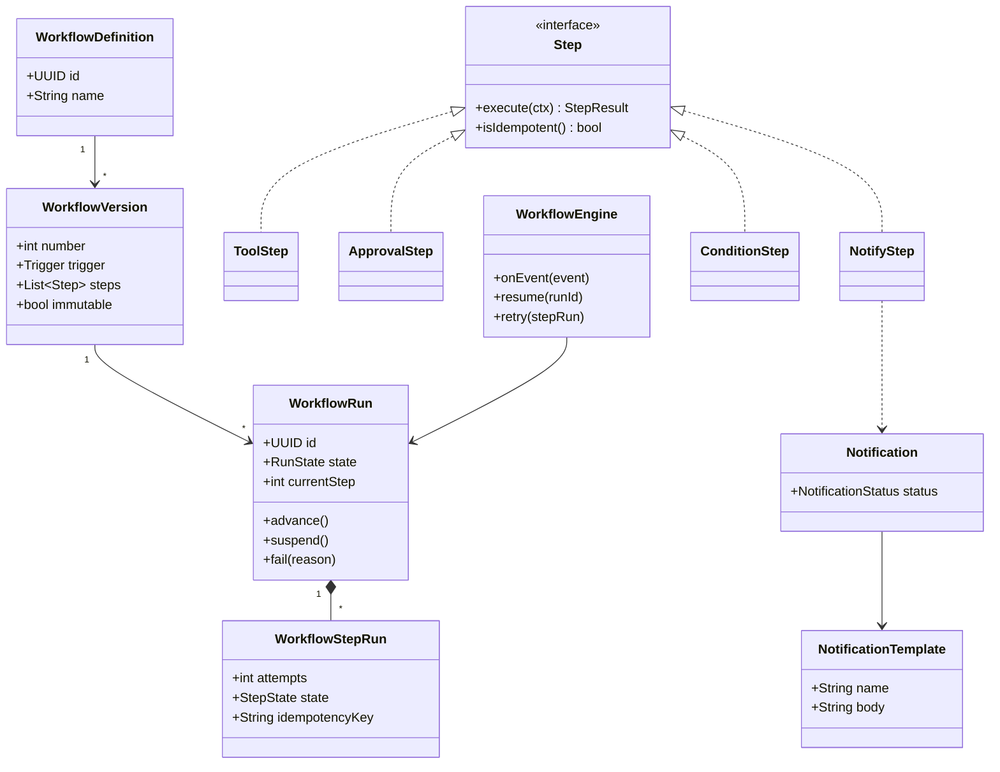

## U2.10 Security, audit, usage and evaluation (M16, M17, M20)

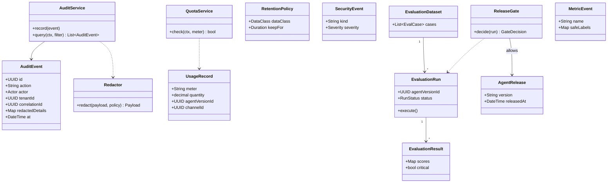

## U2.11 Design patterns applied

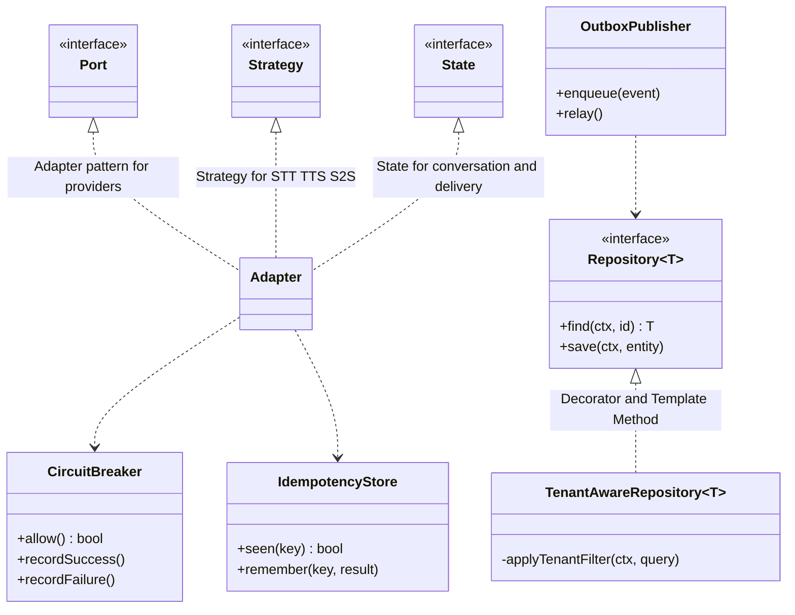
