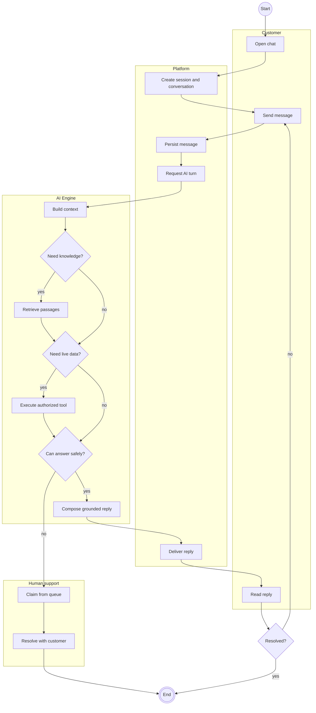
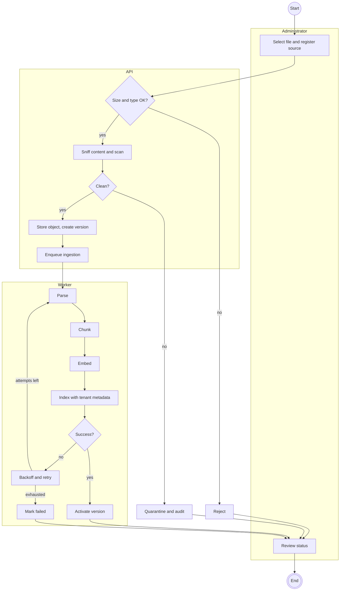
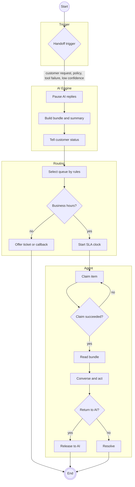
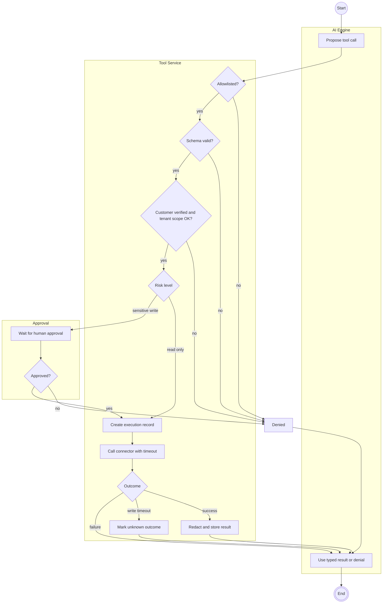
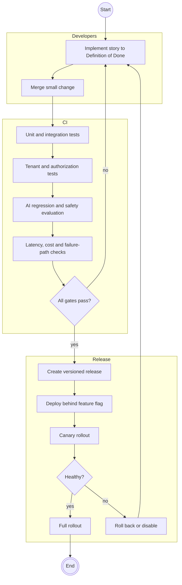
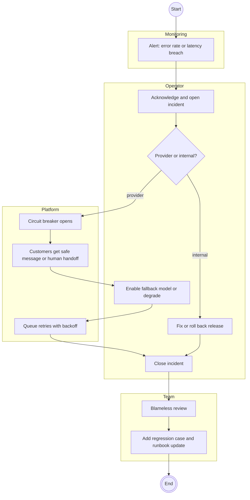

# U4 — UML Activity Diagrams (with swimlanes)

Mermaid has no activity-diagram syntax, so these use flowcharts: initial node `((start))`, final node `(((end)))`, decision diamonds, and one subgraph per swimlane (partition).

## U4.1 Customer support conversation — end to end

## U4.2 Document ingestion

## U4.3 Human handoff

## U4.4 Tool call authorization

## U4.5 Release process

## U4.6 Incident response for provider outage

