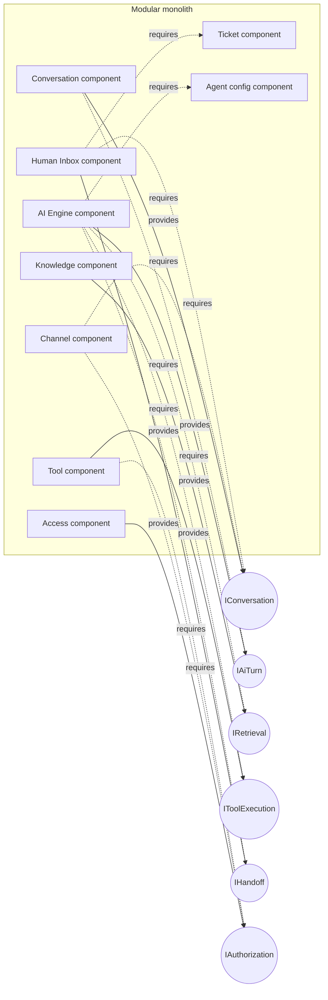
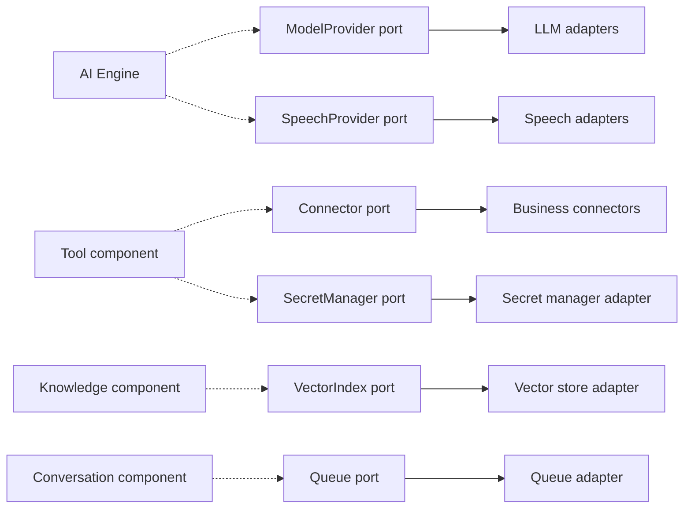
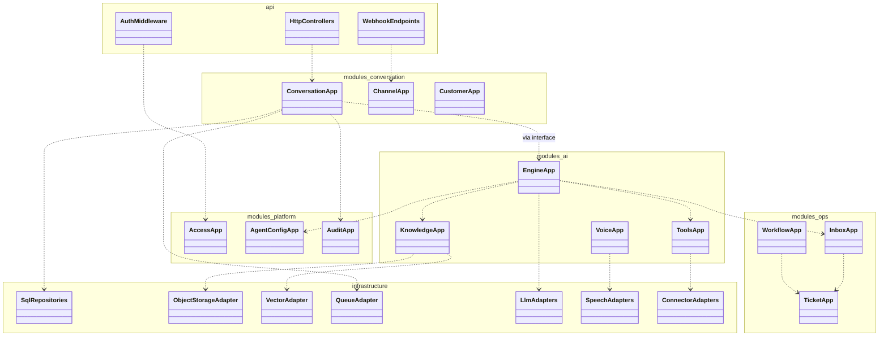
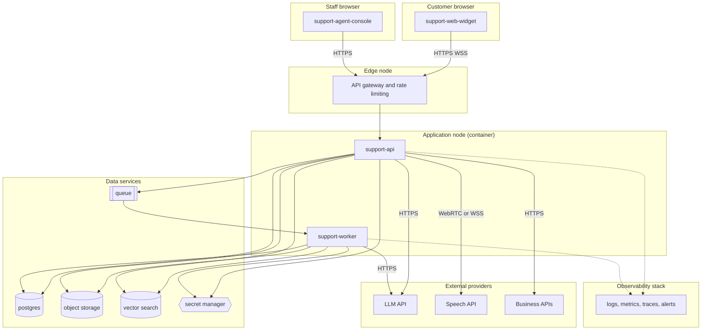
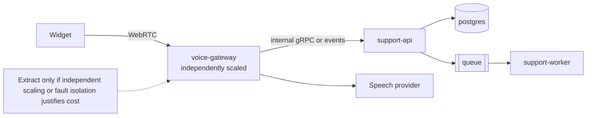
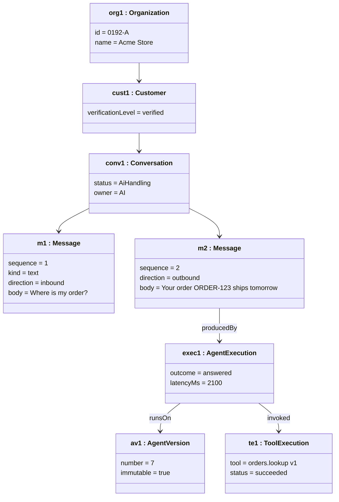
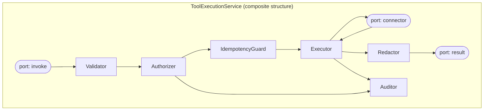

# U5 — UML Structural Diagrams: Component, Package, Deployment, Object

## U5.1 Component diagram: provided and required interfaces

Lollipop notation is approximated: `-->|provides|` shows an exposed interface and `-.->|requires|` a dependency on one.

## U5.1b Component diagram: outbound ports and adapters

## U5.2 Package diagram (code organization and allowed dependencies)

## U5.3 Deployment diagram — MVP

## U5.4 Deployment diagram — later: independent real-time voice component

## U5.5 Object diagram — one live conversation (instance specification)

## U5.6 Composite structure — tool execution internals

